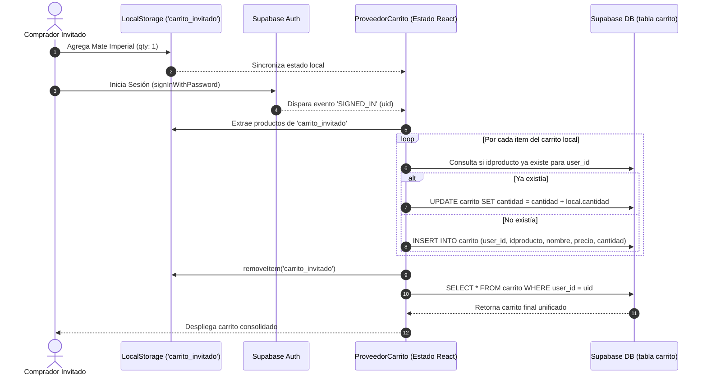
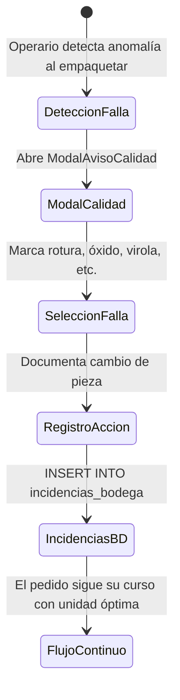
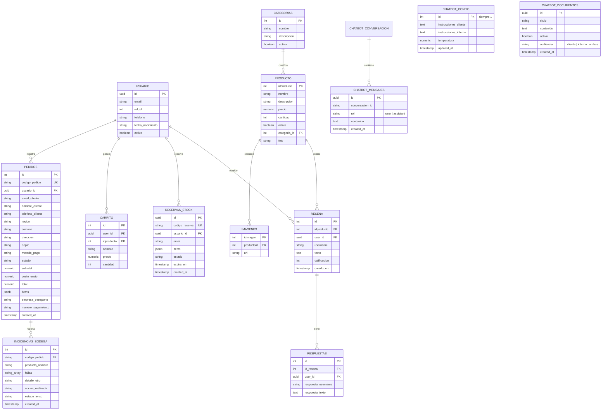
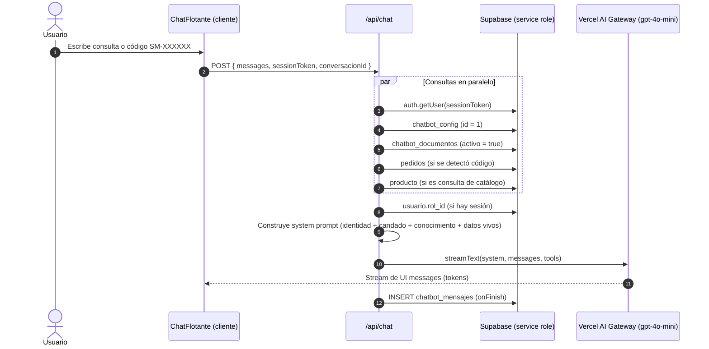
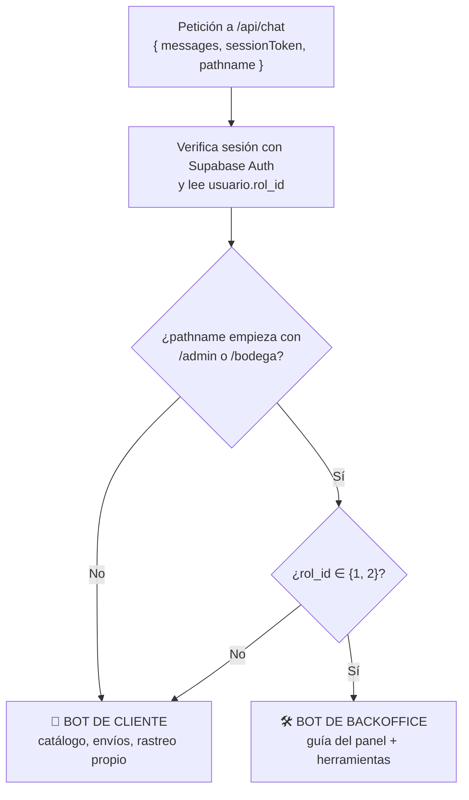

# 📘 Informe Completo de Arquitectura e Implementación: GrowderWeb (SuMateCL)

> **Fecha de Actualización:** 28 de Octubre de 2026  
> **Plataforma:** GrowderWeb — SuMateCL (Next.js 16.3.4 App Router / React 19.2.8 / Supabase / Tailwind CSS v4)  
> **Sistemas Analizados:**  
> 1. `Tienda B2C & Carrito Híbrido` (Navegación, Catálogo Dinámico, Sincronización Local/Nube y Deep Linking Móvil)  
> 2. `Motor de Reservas Temporales & Concurrencia de Inventario` (Bloqueo Atómico de 120s / 5m con Rollback)  
> 3. `Pasarelas de Pago Integradas` (Transbank Webpay Plus & Mercado Pago Checkout Pro)  
> 4. `Servicio de Correo Transaccional` (Nodemailer SMTP Gmail, Desglose de IVA 19% y Resumen de Despacho)  
> 5. `Panel de Administración Back-Office` (Inventario, Galería WebP al 70%, Roles RBAC y WhatsApp Directo)  
> 6. `Sistema Logístico de Bodega & Control de Calidad` (Inspección de Incidencias en `incidencias_bodega`)  
> 7. `Portal de Cliente & Trazabilidad Realtime` (Seguimiento Stepper con Suscripción Postgres Changes)  
> 8. `Asistente Virtual con IA (Chatbot)` (Widget flotante, Vercel AI Gateway, Cerebro de IA configurable y Base de Conocimiento en `/admin/chatbot`)  
> **Autoría / Contexto:** Auditoría Técnica de Arquitectura, Ingeniería de Software, Persistencia y Experiencia Transaccional.

---

## 📑 Tabla de Contenidos

1. [Resumen Ejecutivo y Visión General](#1-resumen-ejecutivo-y-visión-general)
2. [Arquitectura Global en el Ecosistema GrowderWeb](#2-arquitectura-global-en-el-ecosistema-growderweb)
3. [Módulo E-Commerce B2C: Navegación, Catálogo y Búsqueda](#3-módulo-e-commerce-b2c-navegación-catálogo-y-búsqueda)
   - 3.1 Estructura del Módulo y Mapa de Archivos
   - 3.2 Portada Principal Dinámica y Carrusel Publicitario Desacoplado
   - 3.3 Motor de Búsqueda Paramétrico y Filtros Facetados (`/buscar`)
   - 3.4 Vista Detallada de Producto y Galería Interactiva (`/product/[id]`)
   - 3.5 Reseñas y Calificaciones de Producto (paridad con la app Ionic)
4. [Módulo de Carrito Híbrido: Sincronización Local / Cloud](#4-módulo-de-carrito-híbrido-sincronización-local--cloud)
   - 4.1 Dominio y Tipos del Carrito (`ItemCarrito`)
   - 4.2 Arquitectura de Doble Capa: Invitado (`localStorage`) vs Nube (`supabase.carrito`)
   - 4.3 Algoritmo de Fusión Automática (*Merge*) post Inicio de Sesión
   - 4.4 Actualización Optimista de UI y Drawer Lateral (`CarroDesplegable`)
5. [Motor de Reservas Temporales y Concurrencia de Inventario](#5-motor-de-reservas-temporales-y-concurrencia-de-inventario)
   - 5.1 El Problema del *Over-Selling* en Pagos Digitales
   - 5.2 Ciclo de Vida de la Reserva y Countdown de 120s / 5m (`TimerReserva`)
   - 5.3 Endpoints API de Reserva: Iniciar, Completar y Liberar
   - 5.4 Estrategia Híbrida: Funciones Atómicas RPC y Fallback de Contingencia
6. [Pasarelas de Pago: Transbank Webpay Plus y Mercado Pago](#6-pasarelas-de-pago-transbank-webpay-plus-y-mercado-pago)
   - 6.1 Flujo de Checkout y Formulario con División Administrativa de Chile
   - 6.2 Integración Webpay Plus (`transbank-sdk`): Transacción, Commit y Token WS
   - 6.3 Integración Mercado Pago (`mercadopago`): Preferencias y Retorno Automático
   - 6.4 Manejo de Resultados: Páginas de Éxito (`/pago/exito`) y Fracaso (`/pago/fracaso`)
   - 6.5 Pasarela Móvil y Deep Linking a Aplicación Nativa (`suemate://`)
7. [Sistema Transaccional de Correo Electrónico (Nodemailer)](#7-sistema-transaccional-de-correo-electrónico-nodemailer)
   - 7.1 Configuración SMTP con Google Mail (STARTTLS 587)
   - 7.2 Algoritmo de Desglose de Impuestos: Neto, IVA (19%) y Costo de Envío Fijo
   - 7.3 Plantilla HTML Corporativa y Resumen de Despacho
8. [Panel de Administración Central (`/admin`) y RBAC](#8-panel-de-administración-central-admin-y-rbac)
   - 8.1 Barrera Ergonómica de Escritorio (`AdminLayout`)
   - 8.2 Pestaña Inventario: Modificación Rápida y Estados de Disponibilidad
   - 8.3 Formulario de Producto: Creación Dinámica de Categorías y Galería
   - 8.4 Compresor de Imágenes Canvas Client-side (WebP 70% / 1000px)
   - 8.5 Gestión de Roles y Permisos (Admin: 1, Editor: 2, Cliente: 3)
   - 8.6 Consola de Pedidos, Modal de Auditoría y Botón Directo a WhatsApp
   - 8.7 Ficha Integral de Cliente 360° (`/admin/clientes/[id]`) y Gestión de Envíos
9. [Módulo de Bodega, Logística y Control de Calidad (`/bodega`)](#9-módulo-de-bodega-logística-y-control-de-calidad-bodega)
   - 9.1 Acceso Restringido a Operadores de Almacén
   - 9.2 Monitor de Stock Físico (`/bodega/inventario`)
   - 9.3 Despacho y Transición de Estados (`/bodega/pedidos`)
   - 9.4 Sistema de Incidencias de Calidad y Registro en `incidencias_bodega`
   - 9.5 Monitor Público y de Operaciones (`/bodega/estados`)
10. [Portal de Usuario y Trazabilidad en Tiempo Real (`/mis-compras`)](#10-portal-de-usuario-y-trazabilidad-en-tiempo-real-mis-compras)
    - 10.1 Gestión de Perfil y Metadatos de Autenticación (`/cuenta`)
    - 10.2 Componente Stepper de Seguimiento Logístico (5 Fases + Incidencias)
    - 10.3 Suscripción Reactiva Supabase Realtime (`postgres_changes`)
    - 10.4 Botón de Recompra Rápida y Auto-Cancelación de Pedidos Huérfanos
    - 10.5 Imágenes de Producto en Pedidos y Limpieza de Compras sin Completar
11. [Modelo de Datos y Esquema Supabase](#11-modelo-de-datos-y-esquema-supabase)
    - 11.1 Diagrama Entidad-Relación Lógico
    - 11.2 Definición de Tablas Principales
    - 11.3 Procedimientos Almacenados (Funciones RPC)
12. [Matriz Técnica Comparativa de Módulos y Resiliencia](#12-matriz-técnica-comparativa-de-módulos-y-resiliencia)
13. [Auditoría de Rendimiento, Seguridad y Recomendaciones de Evolución](#13-auditoría-de-rendimiento-seguridad-y-recomendaciones-de-evolución)
14. [Asistente Virtual con IA: Chatbot SuMate Bot y Cerebro de IA](#14-asistente-virtual-con-ia-chatbot-sumate-bot-y-cerebro-de-ia)
    - 14.1 Visión General y Mapa de Archivos
    - 14.2 Widget Flotante del Cliente (`ChatFlotante.tsx`)
    - 14.3 Endpoint de Conversación (`/api/chat`): Pipeline de Respuesta
    - 14.4 Sistema de Conmutación Preset vs Cerebro de IA
    - 14.5 Inyección de Datos en Tiempo Real (Pedidos y Catálogo)
    - 14.6 Candado Temático, Herramienta `consultarEstadoPedido` y Persistencia
    - 14.7 Panel Admin "Cerebro de IA" (`/admin/chatbot`) y Extracción de PDF
    - 14.8 Modelo de Datos del Chatbot
    - 14.9 Hallazgos de Auditoría y Mejoras Propuestas
    - 14.10 Doble Identidad por Contexto: Bot de Cliente vs Bot de Backoffice
    - 14.11 Herramientas Operativas del Backoffice y Controles de Seguridad
    - 14.12 Privacidad: Audiencia de Documentos y Pedidos Solo para su Dueño

---

## 1. Resumen Ejecutivo y Visión General

**GrowderWeb** es la plataforma tecnológica integral de comercio electrónico y gestión omnicanal de inventario diseñada para **SuMate / SuMateCL**, empresa especializada en la comercialización de mates, bombillas, termos, materas y accesorios artesanales en Chile.

A diferencia de soluciones monolíticas tradicionales o tiendas de plantilla estándar, GrowderWeb implementa una arquitectura híbrida de alta disponibilidad:
- **E-Commerce de Alta Fidelidad Visual:** Interfaz con diseño editorial artesanal (paleta basada en tonos tierra, olivo `#314235`, arena `#f8f3e9` y tipografía corporativa uniforme).
- **Carrito Híbrido con Sincronización Inteligente:** Permite a clientes navegar y armar carritos como invitados en `localStorage`; al iniciar sesión, el sistema transfiere de forma transparente las selecciones hacia Supabase Database (`public.carrito`) sin pérdida de datos.
- **Sistema Concurrente de Reserva Temporal de Stock:** Mitiga el riesgo de sobreventa (*over-selling*) al congelar unidades durante el proceso de pago por una ventana estricta de 120 segundos (ampliable a 5 minutos en confirmación final), implementando mecanismos de desahogo automático (*rollback*) ante expiración o rechazo.
- **Integración Dual de Pasarelas de Pago Chilenas:** Soporte nativo para **Transbank Webpay Plus** (tarjetas de débito/crédito chilenas vía Redcompra) y **Mercado Pago Checkout Pro**.
- **Puente con Ecosistema Móvil:** Soporte de redirección por *Deep Linking* hacia esquemas nativos `suemate://` para flujos iniciados desde aplicaciones móviles Android / iOS.
- **Operación Back-Office Segmentada:** Paneles administrativos dedicados para gerencia (`/admin`) y operarios de almacén (`/bodega`), blindados contra dispositivos móviles para garantizar una ergonomía y control de inventario rigurosos.
- **Trazabilidad en Tiempo Real:** El comprador puede visualizar el avance de su pedido etapa por etapa con un componente Stepper conectado mediante WebSockets a Supabase Realtime.
- **Asistente Virtual con IA (SuMate Bot):** Chatbot flotante en toda la tienda, basado en Vercel AI SDK y Vercel AI Gateway (`gpt-4o-mini`), que responde consultas de catálogo, envíos y rastreo de pedidos `SM-XXXXXX` con datos reales de Supabase. Su personalidad y conocimiento se administran desde el panel `/admin/chatbot` ("Cerebro de IA"). Tiene **dos identidades según el contexto**: asesor de ventas en la tienda y asistente operativo dentro de `/admin` y `/bodega`, donde además puede ejecutar operaciones (con permisos y confirmación validados en el servidor).

---

## 2. Arquitectura Global en el Ecosistema GrowderWeb

El siguiente diagrama ilustra la topología de servicios, clientes, bases de datos y pasarelas bancarias:

```mermaid
graph TB
    subgraph Clientes ["Capa de Clientes"]
        WEB_DESKTOP["Navegador Desktop<br/>(Chrome / Safari / Edge)"]
        WEB_MOBILE["Navegador Móvil<br/>(Safari / Chrome Mobile)"]
        APP_NATIVE["App Móvil Nativa<br/>(Esquema: suemate://)"]
    end

    subgraph FrontendApp ["Frontend / BFF: Next.js 16.3.4 (App Router)"]
        STORE_UI["Tienda Pública<br/>(/, /buscar, /product/[id])"]
        CART_CTX["ProveedorCarrito<br/>(Local + Cloud Sync)"]
        AUTH_CTX["AuthProvider<br/>(RBAC: Admin, Editor, Cliente)"]
        CHECKOUT_UI["Flujo Checkout<br/>(/confirmacion-pago, TimerReserva)"]
        ADMIN_PORTAL["Portal Admin<br/>(/admin, Inventario, Roles, Pedidos)"]
        BODEGA_PORTAL["Portal Bodega<br/>(/bodega, Control de Calidad)"]
        CUSTOMER_PORTAL["Portal Cliente<br/>(/cuenta, /mis-compras, Stepper)"]
        CHAT_WIDGET["ChatFlotante<br/>(Widget global en layout.tsx)"]
        CHAT_ADMIN["Cerebro de IA<br/>(/admin/chatbot)"]
        CHAT_API["/api/chat (streamText)<br/>/api/admin/chatbot/extraer-pdf"]

        API_ROUTES["Route Handlers (Serverless)<br/>/api/webpay/*, /api/mercadopago/*<br/>/api/reserva/*, /api/email/*"]
    end

    subgraph BaaS ["Persistencia y Realtime: Supabase"]
        SB_AUTH["Supabase Auth<br/>(JWT Sessions, Metadata)"]
        SB_DB[("PostgreSQL Database<br/>producto, pedidos, reservas,<br/>carrito, incidencias_bodega")]
        SB_REALTIME["Supabase Realtime Engine<br/>(Canal: mis-compras-cliente-realtime)"]
        SB_RPC["Funciones Almacenadas (RPC)<br/>confirmar_pago_pedido, cancelar_pedido,<br/>crear_reserva_stock, completar_reserva"]
        SB_CHATDB[("Tablas del Chatbot<br/>chatbot_config, chatbot_documentos,<br/>chatbot_mensajes")]
    end

    subgraph Pasarelas ["Pasarelas Financieras y Servicios Externos"]
        WEBPAY["Transbank Webpay Plus<br/>(Ambiente Integración / Producción)"]
        MP["Mercado Pago API<br/>(Checkout Pro Preferences)"]
        SMTP_GMAIL["Servidor SMTP Gmail<br/>(Nodemailer TLS :587)"]
        NGROK["Túnel Ngrok Dev<br/>(fondling-bottling-explore.ngrok-free.dev)"]
        VGATEWAY["Vercel AI Gateway<br/>(OpenAI gpt-4o-mini)"]
    end

    WEB_DESKTOP --> STORE_UI
    WEB_DESKTOP --> ADMIN_PORTAL
    WEB_DESKTOP --> BODEGA_PORTAL
    WEB_MOBILE --> STORE_UI
    WEB_MOBILE --> CUSTOMER_PORTAL
    APP_NATIVE -.->|"Deep Link Return"| API_ROUTES

    STORE_UI --> CART_CTX
    STORE_UI --> AUTH_CTX
    CHECKOUT_UI --> API_ROUTES
    CUSTOMER_PORTAL <== "WebSocket Realtime" ==> SB_REALTIME

    API_ROUTES <== "Transbank SDK" ==> WEBPAY
    API_ROUTES <== "MercadoPago SDK" ==> MP
    API_ROUTES --> SMTP_GMAIL
    API_ROUTES <== "PostgREST & RPC" ==> SB_DB
    API_ROUTES --> SB_RPC
    AUTH_CTX <== "Auth Listener" ==> SB_AUTH

    NGROK -.->|"Dev Webhooks / Return"| API_ROUTES

    STORE_UI --> CHAT_WIDGET
    CHAT_WIDGET <== "Stream UI Messages" ==> CHAT_API
    CHAT_ADMIN --> CHAT_API
    CHAT_API <== "OpenAI-compatible" ==> VGATEWAY
    CHAT_API <== "Service Role" ==> SB_CHATDB
    CHAT_API --> SB_DB
```



### Principios Fundamentales del Sistema
1. **Frontend Desacoplado y SSR Mixto:** La portada y catálogo combinan Server Components y Client Components optimizados con hidratación selectiva.
2. **Defensa en Profundidad (RBAC):** La seguridad no confía en la interfaz; se valida numéricamente a través de `rol_id` en `usuario` (1: Admin, 2: Editor/Bodeguero, 3: Cliente) y se complementa con procedimientos de base de datos.
3. **Idempotencia Transaccional:** Cada orden de compra (`buyOrder` / `codigo_pedido`) posee un identificador aleatorio de formato `SM-XXXXXX` que previene el doble cobro y la duplicación de pedidos en retornos bancarios concurrentes.

---

## 3. Módulo E-Commerce B2C: Navegación, Catálogo y Búsqueda

### 3.1 Estructura del Módulo y Mapa de Archivos

```
app/
├── page.tsx                           # Portada principal: catálogo, banners y footer
├── layout.tsx                         # RootLayout: ProveedorCarrito, AuthProvider y CarroDesplegable
├── globals.css                        # Tokens de diseño, tipografía corporativa y Tailwind v4
├── buscar/
│   ├── page.tsx                       # Controlador de búsqueda y filtros reactivos
│   └── components/
│       ├── FiltrosBusqueda.tsx        # Selector de ordenamiento y categorías
│       └── GridResultados.tsx         # Rejilla adaptativa con tarjetas de producto
├── product/[id]/
│   ├── page.tsx                       # Ficha técnica, carrusel de fotos, selector de unidades y resumen de estrellas
│   └── components/
│       └── ResenasProducto.tsx        # Calificaciones, reseñas y respuestas (tablas resena / respuestas)
└── components/
    ├── SubNavbar.tsx                  # Navegación secundaria con categorías desde BD
    └── BarraBusquedaNav.tsx           # Input de búsqueda universal con botón limpiador
```

### 3.2 Portada Principal Dinámica y Carrusel Publicitario Desacoplado

Ubicada en [`app/page.tsx`](file:///f:/Growder/GROWDER/Desarrollo%20App%20y%20Web/GrowderWeb/app/page.tsx):
- **Catálogo Reactivo:** Consulta en Supabase todos los productos donde `activo === true`, ordenados por `idproducto DESC`.
- **Asociación de Galería:** Cruza en cliente la tabla `producto` con la tabla `imagenes` para extraer la fotografía destacada de cada mate o accesorio.
- **Carrusel Publicitario Independiente:** Diseñado exclusivamente para banners promocionales estáticos (`BANNERS`), manteniendo estrictamente separada la publicidad gráfica del catálogo transaccional.
- **Acceso Administrativo Directo:** Si el usuario autenticado posee rol de Administrador o Editor (`rol_id === 1 || 2`), la barra de navegación despliega accesos directos al panel `/admin` y a la consola de `/bodega`.

### 3.3 Motor de Búsqueda Paramétrico y Filtros Facetados (`/buscar`)

Implementado en [`app/buscar/page.tsx`](file:///f:/Growder/GROWDER/Desarrollo%20App%20y%20Web/GrowderWeb/app/buscar/page.tsx):
- **Lectura Bidireccional de Query Params:** Escucha `?q=...`, `?categoria=...` y `?orden=...` (`reciente`, `precio-asc`, `precio-desc`).
- **Sincronización con el Historial del Navegador:** Detecta variaciones en `searchParams` y actualiza el estado interno sin provocar recargas completas de página.
- **Filtrado Multidimensional en Memoria:**
  - Coincidencia insensible a mayúsculas/minúsculas en nombre y descripción.
  - Normalización de tildes y caracteres especiales.
  - Agrupación por categoría dinámica extraída de la tabla `categorias`.

```typescript
// Lógica de filtrado en app/buscar/page.tsx
const productosFiltrados = useMemo(() => {
  return productos
    .filter((prod) => {
      const coincideTexto =
        !busquedaTexto.trim() ||
        prod.nombre.toLowerCase().includes(busquedaTexto.toLowerCase()) ||
        prod.descripcion.toLowerCase().includes(busquedaTexto.toLowerCase());

      const coincideCategoria =
        categoriaSeleccionada === 'todos' ||
        String(prod.categoria_id) === String(categoriaSeleccionada) ||
        prod.categoria?.toLowerCase() === String(categoriaSeleccionada).toLowerCase();

      return coincideTexto && coincideCategoria;
    })
    .sort((a, b) => {
      if (ordenPrecio === 'precio-asc') return a.precio - b.precio;
      if (ordenPrecio === 'precio-desc') return b.precio - a.precio;
      return b.idproducto - a.idproducto; // Recientes por defecto
    });
}, [productos, busquedaTexto, categoriaSeleccionada, ordenPrecio]);
```

### 3.4 Vista Detallada de Producto y Galería Interactiva (`/product/[id]`)

En [`app/product/[id]/page.tsx`](file:///f:/Growder/GROWDER/Desarrollo%20App%20y%20Web/GrowderWeb/app/product/%5Bid%5D/page.tsx):
- **Extracción de Parámetros:** Utiliza `useParams()` para recuperar el identificador.
- **Carga de Galería Combinada:** Prioriza la fotografía principal del registro (`producto.foto`) y añade secuencialmente todas las imágenes asociadas en la tabla `imagenes` deduplicando URLs.
- **Manejo de Estados de Carga y Error Elegante:** Si el producto no existe o fue dado de baja, renderiza una pantalla integrada que mantiene la cabecera corporativa e invita a explorar el resto de la colección, evitando pantallazos de error 404 abruptos.
- **Selector de Cantidades:** Limita la selección máxima a la cantidad disponible en el stock real (`producto.cantidad`).
- **Resumen de Valoración:** Bajo el título se muestran las estrellas, el promedio y el número de reseñas (p. ej. *4.5 · 3 reseñas*, o *Sin reseñas aún*); el enlace baja a la sección de reseñas.

### 3.5 Reseñas y Calificaciones de Producto (paridad con la app Ionic)

Implementado en [`app/product/[id]/components/ResenasProducto.tsx`](file:///f:/Growder/GROWDER/Desarrollo%20App%20y%20Web/GrowderWeb/app/product/%5Bid%5D/components/ResenasProducto.tsx), replicando el comportamiento de `DtproductoPage` / `ReviewService` de la aplicación móvil y **compartiendo las mismas tablas de Supabase**, por lo que una reseña escrita en la app aparece en la web y viceversa.

- **Calificación 1 a 5 estrellas:** selector interactivo; el envío exige al menos 1 estrella y texto.
- **Reseñas:** tarjeta con avatar (inicial del nombre), autor, estrellas, texto e insignia *Compra verificada*. Listado ascendente por `id`.
- **Hilo de respuestas anidado:** cada reseña admite réplicas (`respuestas`); si una respuesta no trae autor se muestra *Growder Team*. Se envían con botón o con Enter.
- **Sesión:** sin sesión se ve el listado y un enlace a `/login`; para escribir o responder se requiere sesión. El nombre visible es el primer nombre de `user_metadata` (`nombre`, `full_name` o `name`) o, en su defecto, la parte local del correo.
- **Sección desplegable** (*Reseñas (N)*, abierta por defecto) con avisos temporales de validación y error.
- **Tablas:** `resena` (`id`, `idproducto`, `username`, `texto`, `calificacion`, `user_id`, `creado_en`) y `respuestas` (`id_resena`, `respuesta_username`, `respuesta_texto`, `user_id`).
- **Nota técnica:** la fecha de la reseña se llama `creado_en` (no `created_at`); por eso las consultas ordenan por `id`, columna presente en ambas tablas.
- **Pendiente de endurecer:** la insignia *Compra verificada* se muestra en todas las reseñas (igual que en la app) sin comprobar que el autor haya comprado el producto.

---

## 4. Módulo de Carrito Híbrido: Sincronización Local / Cloud

### 4.1 Dominio y Tipos del Carrito

Definido en [`app/datoscarro/estadocarro.tsx`](file:///f:/Growder/GROWDER/Desarrollo%20App%20y%20Web/GrowderWeb/app/datoscarro/estadocarro.tsx):

```typescript
export interface ItemCarrito {
  id: string;
  nombre: string;
  precio: number;
  imagen: string;
  cantidad: number;
}

interface ContextoCarritoTipo {
  carrito: ItemCarrito[];
  agregarAlCarrito: (producto: Omit<ItemCarrito, 'cantidad'>, cantidad?: number) => void;
  eliminarDelCarrito: (id: string) => void;
  actualizarCantidad?: (id: string, delta: number) => void;
  limpiarCarrito?: () => void;
  carritoAbierto: boolean;
  setCarritoAbierto: (abierto: boolean) => void;
  total: number;
}
```

### 4.2 Arquitectura de Doble Capa: Invitado vs Nube

El carrito opera con dos estrategias de persistencia según el estado de la sesión:
1. **Modo Invitado (Sin Sesión):**
   - El carrito se lee y escribe íntegramente en `localStorage.getItem('carrito_invitado')`.
   - Permite al comprador interactuar con el sitio con cero fricción y sin requerir autenticación previa.
2. **Modo Usuario Autenticado (Con Sesión):**
   - La verdad del carrito reside en la tabla `public.carrito` de Supabase vinculada por `user_id`.
   - Cada inserción o actualización se refleja de manera persistente en base de datos.
   - La tabla `carrito` no almacena fotografías: al cargar el carrito desde la nube, `obtenerFotosProductos()` ([`src/lib/imagenesProducto.ts`](file:///f:/Growder/GROWDER/Desarrollo%20App%20y%20Web/GrowderWeb/src/lib/imagenesProducto.ts)) resuelve la imagen real de cada producto (tabla `imagenes`, con `producto.foto` de respaldo). Antes se usaba un *placeholder* inexistente que quedaba grabado en los pedidos (ver 10.5).

### 4.3 Algoritmo de Fusión Automática (*Merge*) post Inicio de Sesión

Cuando un cliente que añadió productos como invitado decide iniciar sesión o registrarse, el listener `onAuthStateChange` detecta el evento `SIGNED_IN` y ejecuta la fusión:



### 4.4 Actualización Optimista de UI y Drawer Lateral (`CarroDesplegable`)

- **Respuesta Instantánea:** Al presionar *Añadir al Carro*, el hook actualiza inmediatamente el estado en React (`setCarrito`) antes de que la promesa de red hacia Supabase resuelva, eliminando cualquier sensación de lentitud.
- **Drawer Deslizante (`CarroDesplegable.tsx`):**
  - Panel flotante fijado al lateral derecho con fondo semitransparente con desenfoque (`backdrop-blur-xs`).
  - Permite incrementar, reducir o remover unidades, mostrando el subtotal en tiempo real.
  - Acceso directo al botón *Finalizar Compra*, el cual redirige hacia `/confirmacion-pago`.

---

## 5. Motor de Reservas Temporales y Concurrencia de Inventario

### 5.1 El Problema del *Over-Selling* en Pagos Digitales

En el comercio electrónico de artículos con stock limitado (como mates de calabaza seleccionada o piezas de alpaca artesanales), si dos compradores inician simultáneamente el pago de la última unidad mediante Transbank o Mercado Pago, ambos podrían ser cobrados si el inventario solo se descuenta tras la confirmación bancaria.

GrowderWeb resuelve esto implementando una **reserva temporal atómica con ventana de expiración**.

### 5.2 Ciclo de Vida de la Reserva y Countdown (`TimerReserva`)

El componente [`TimerReserva.tsx`](file:///f:/Growder/GROWDER/Desarrollo%20App%20y%20Web/GrowderWeb/app/confirmacion-pago/components/TimerReserva.tsx) actúa como árbitro temporal en la pantalla de confirmación:
- **Duración Estándar:** 120 segundos (2 minutos) para reserva inmediata; ampliado a 300 segundos (5 minutos) durante la sesión de pago final.
- **Indicadores Visuales de Urgencia:**
  - $\text{Tiempo} > 60\text{s}$: Tono neutro / bosque (`#314235`).
  - $30\text{s} < \text{Tiempo} \le 60\text{s}$: Tono ámbar de advertencia (`bg-amber-50`).
  - $\text{Tiempo} \le 30\text{s}$: Tono crítico carmesí pulsante (`bg-rose-50 text-rose-800 animate-pulse`).
- **Modal Bloqueante de Expiración:** Si el contador llega a `00:00`, se congela la interfaz y se despliega un diálogo explicativo informando al usuario que sus artículos han retornado al stock general, ofreciendo botones para *Volver a reservar* o *Volver a la tienda*.

### 5.3 Endpoints API de Reserva: Iniciar, Completar y Liberar

| Endpoint | Método | Entrada Principal | Salida / Efecto |
| :--- | :---: | :--- | :--- |
| `/api/reserva/iniciar` | `POST` | `{ items, usuarioId, email, codigoReserva? }` | Descuenta preventivamente el stock en `producto`, crea registro en `reservas_stock` con `expira_en` y devuelve `{ success: true, codigoReserva, expiraEn }`. Rechaza con `409` si no hay stock suficiente. |
| `/api/reserva/completar` | `POST` | `{ codigoReserva }` | Marca la reserva como `completada`, consolidando la venta definitivamente. |
| `/api/reserva/liberar` | `POST` | `{ codigoReserva, items?, motivo? }` | Restaura las unidades sumándolas nuevamente a la columna `cantidad` de `producto` y actualiza la reserva a `cancelada` o `expirada`. |

### 5.4 Estrategia Híbrida: Funciones Atómicas RPC y Fallback de Contingencia

Las rutas API están programadas bajo un patrón de **resiliencia de dos fases**:
1. **Fase Primaria (RPC Atómico en PostgreSQL):** Invoca `supabase.rpc('crear_reserva_stock', ...)`. Esto ejecuta un bloqueo a nivel de fila (`FOR UPDATE`) en la base de datos, garantizando atomicidad transaccional pura.
2. **Fase Secundaria (Fallback de Aplicación):** Si la función RPC no estuviese disponible, la API ejecuta una rutina de limpieza de reservas vencidas, verifica el stock disponible, actualiza la tabla `producto` y persiste en `reservas_stock`.

---

## 6. Pasarelas de Pago: Transbank Webpay Plus y Mercado Pago

### 6.1 Flujo de Checkout y Formulario con División Administrativa de Chile

En [`app/confirmacion-pago/page.tsx`](file:///f:/Growder/GROWDER/Desarrollo%20App%20y%20Web/GrowderWeb/app/confirmacion-pago/page.tsx):
- **Normalización Territorial Chilena:** Lista estricta con las 16 regiones oficiales de Chile (`REGIONES_CHILE`) desde *Arica y Parinacota* hasta *Magallanes y de la Antártica Chilena*.
- **Estructura Tarifaria Fija:** Costo de despacho centralizado en `$2.650 CLP` (`COSTO_ENVIO_FIJO`).
- **Generador de Órdenes:** Crea códigos con prefijo `SM-` seguidos de 6 dígitos aleatorios (ej. `SM-492810`).

```mermaid
graph TD
    A[Cliente en /confirmacion-pago] --> B{¿Está autenticado?}
    B -- No --> C[Despliega formulario Auth Inline: Login / Registro]
    B -- Sí --> D[Completa datos de envío y selecciona Pasarela]
    
    D --> E{Medio de Pago}
    E -->|Webpay Plus| F[POST /api/webpay/create]
    F --> G[Crea Formulario POST invisible con token_ws y envía a Transbank]
    G --> H[Pantalla Bancaria Redcompra / Webpay]
    
    E -->|Mercado Pago| I[POST /api/mercadopago/create]
    I --> J[Redirige a init_point de Checkout Pro]
    J --> K[Portal de Pago Mercado Pago]

    H -->|Transacción Aprobada| L[POST/GET /api/webpay/commit]
    H -->|Usuario Cancela| M[POST/GET /api/webpay/commit?TBK_TOKEN=...]
    K -->|Retorno Aprobado| N[/pago/exito?payment_id=...]
    K -->|Retorno Fallido| O[/pago/fracaso?motivo=rechazado]

    L --> P[RPC confirmar_pago_pedido + Disparo de Correo]
    P --> Q[/pago/exito]
    M --> R[RPC cancelar_pedido + Liberación de Stock]
    R --> S[/pago/fracaso]
```

### 6.2 Integración Webpay Plus (`transbank-sdk`)

Ubicada en [`app/api/webpay/create/route.ts`](file:///f:/Growder/GROWDER/Desarrollo%20App%20y%20Web/GrowderWeb/app/api/webpay/create/route.ts) y [`commit/route.ts`](file:///f:/Growder/GROWDER/Desarrollo%20App%20y%20Web/GrowderWeb/app/api/webpay/commit/route.ts):
- **Inicialización:**
  ```typescript
  const tx = new WebpayPlus.Transaction(
    new Options(
      IntegrationCommerceCodes.WEBPAY_PLUS,
      IntegrationApiKeys.WEBPAY,
      Environment.Integration
    )
  );
  const response = await tx.create(buyOrder, sessionId, amount, returnUrl);
  ```
- **Recepción Dual GET/POST:** El callback de Transbank puede enviar el token por `POST` (formulario `application/x-www-form-urlencoded`) o por `GET` (parámetros de consulta). La función auxiliar `procesarRetornoTransbank` unifica la captura tanto de `token_ws` como de `TBK_TOKEN` y `TBK_ORDEN_COMPRA`.
- **Detección de Cancelación:** Si se recibe `TBK_TOKEN` sin `token_ws`, el cliente canceló voluntariamente la compra en la pantalla del banco. El backend ejecuta de inmediato:
  ```typescript
  await supabase.rpc('cancelar_pedido', {
    p_codigo_pedido: TBK_ORDEN_COMPRA,
    p_motivo: 'cancelado'
  });
  ```
- **Detección de Dominio Dinámico (Ngrok / Producción):** La función `obtenerDominioReal` analiza `x-forwarded-host` y `x-forwarded-proto`, garantizando redirecciones correctas tanto en despliegues como en pruebas locales con túneles Ngrok.

### 6.3 Integración Mercado Pago (`mercadopago`)

En [`app/api/mercadopago/create/route.ts`](file:///f:/Growder/GROWDER/Desarrollo%20App%20y%20Web/GrowderWeb/app/api/mercadopago/create/route.ts):
- Utiliza el cliente oficial `MercadoPagoConfig` con `process.env.MP_ACCESS_TOKEN`.
- Configura `back_urls` apuntando a `/pago/exito` y `/pago/fracaso` con `auto_return: 'approved'`.
- Retorna el enlace de pago directo `response.init_point`.

### 6.4 Manejo de Resultados: Páginas de Éxito y Fracaso

- **Página de Éxito ([`app/pago/exito/page.tsx`](file:///f:/Growder/GROWDER/Desarrollo%20App%20y%20Web/GrowderWeb/app/pago/exito/page.tsx)):**
  - Limpia el carrito de compras mediante `limpiarCarrito()` de forma idempotente con referencia `useRef(false)` para evitar ejecuciones múltiples.
  - Elimina de `sessionStorage` la clave `sumate_reserva_activa`.
  - Si el pago proviene de Mercado Pago (`payment_id`), ejecuta la confirmación RPC `confirmar_pago_pedido` y despacha el correo transaccional.
- **Página de Fracaso ([`app/pago/fracaso/page.tsx`](file:///f:/Growder/GROWDER/Desarrollo%20App%20y%20Web/GrowderWeb/app/pago/fracaso/page.tsx)):**
  - Interpreta los motivos: `cancelado`, `rechazado`, `sin_token` o `error_confirmacion`.
  - Dispara la liberación de inventario vía `cancelar_pedido` y proporciona un botón para retornar a la caja sin perder la selección de productos.

### 6.5 Pasarela Móvil y Deep Linking a Aplicación Nativa (`suemate://`)

Implementado en [`app/api/pago/mobile-redirect/route.ts`](file:///f:/Growder/GROWDER/Desarrollo%20App%20y%20Web/GrowderWeb/app/api/pago/mobile-redirect/route.ts):
- Cuando la transacción es iniciada desde una aplicación móvil embebida en un Webview o Custom Tab, la redirección bancaria aterriza en este endpoint.
- El servidor genera una respuesta HTML ligera con `meta http-equiv="refresh"` y script de redirección forzada hacia el esquema de aplicación:
  - Éxito: `suemate://pago/exito?orden=SM-XXXXXX&monto=YYYY&metodo=...`
  - Fallo: `suemate://pago/fracaso?motivo=...`

---

## 7. Sistema Transaccional de Correo Electrónico (Nodemailer)

### 7.1 Configuración SMTP con Google Mail

Ubicado en [`app/api/email/confirmacion-pago/route.ts`](file:///f:/Growder/GROWDER/Desarrollo%20App%20y%20Web/GrowderWeb/app/api/email/confirmacion-pago/route.ts):
- **Transporte:** Nodemailer conectado a `smtp.gmail.com` en el puerto `587` con protocolo `STARTTLS` (`secure: false`).
- **Autenticación:** Utiliza credenciales de aplicación de 16 caracteres (`process.env.SMTP_USER` y `process.env.SMTP_PASS`).

### 7.2 Algoritmo de Desglose de Impuestos

En concordancia con la legislación tributaria chilena, los productos exhiben precios brutos con IVA incluido. El endpoint realiza el desglose matemático exacto:

$$\text{Neto} = \text{round}\left(\frac{\text{Subtotal}}{1.19}\right)$$
$$\text{IVA (19\%)} = \text{Subtotal} - \text{Neto}$$
$$\text{Total Pagado} = \text{Subtotal} + \text{Costo Envio}$$

### 7.3 Plantilla HTML Corporativa y Resumen de Despacho

El correo generado cuenta con:
1. Barra superior decorativa verde bosque (`#314235`, altura 6px).
2. Título de orden destacada `#SM-XXXXXX`.
3. Tabla iterativa de productos adquiridos con cantidad, precio unitario y subtotal formateado en moneda chilena (`$XX.XXX CLP`).
4. Tarjeta resumen con desglose de Neto, IVA, Despacho y Total.
5. Bloque de datos de despacho: Destinatario, Teléfono, Dirección, Departamento/Oficina, Comuna, Región e Instrucciones de entrega especiales.
6. Pie institucional de SuMateCL.

---

## 8. Panel de Administración Central (`/admin`) y RBAC

### 8.1 Barrera Ergonómica de Escritorio (`AdminLayout`)

Ubicado en [`app/admin/layout.tsx`](file:///f:/Growder/GROWDER/Desarrollo%20App%20y%20Web/GrowderWeb/app/admin/layout.tsx):
- Detecta si el ancho de pantalla es inferior a 1024px (`window.innerWidth < 1024`).
- Si se detecta un dispositivo móvil o tablet vertical, bloquea la visualización del panel administrativo y muestra una pantalla informativa solicitando ingresar desde un computador de escritorio, previniendo errores de edición accidental en pantallas táctiles pequeñas.

### 8.2 Pestaña Inventario: Modificación Rápida

- **Listado y Filtros:** Muestra los productos con fotografía en miniatura, categoría, precio, stock actual y selector de estado activo/inactivo con guardado reactivo.
- **Eliminación Segura:** Diálogo de confirmación modal que previene borrados involuntarios.

### 8.3 Formulario de Producto y Categorías Dinámicas

- **Creación en Caliente:** Si una categoría requerida no existe en la base de datos, el formulario permite ingresarla y presiona la creación instantánea en la tabla `categorias` mediante `crearCategoria()`, seleccionándola automáticamente sin salir del formulario.
- **Soporte de Galería:** Permite asociar hasta 3 imágenes por producto.

### 8.4 Compresor de Imágenes Canvas Client-side

Implementado en [`app/admin/utils/imageOptimizer.ts`](file:///f:/Growder/GROWDER/Desarrollo%20App%20y%20Web/GrowderWeb/app/admin/utils/imageOptimizer.ts):
- **Redimensionamiento Proporcional:** Acota las dimensiones máximas a 1000×1000 píxeles manteniendo la relación de aspecto.
- **Compresión WebP:** Exporta la imagen comprimida al 70% de calidad (`canvas.toDataURL("image/webp", 0.7)`).
- **Ahorro de Ancho de Banda:** Reduce archivos pesados de 5 MB a menos de 150 KB antes de ser transmitidos a la red.

### 8.5 Gestión de Roles y Permisos (RBAC)

Controlado en [`app/admin/components/RolesTab.tsx`](file:///f:/Growder/GROWDER/Desarrollo%20App%20y%20Web/GrowderWeb/app/admin/components/RolesTab.tsx):
- **Jerarquía de Roles:**
  - `rol_id = 1`: **Administrador** (Acceso total: inventario, finanzas, roles, despachos).
  - `rol_id = 2`: **Editor / Bodeguero** (Gestión de productos, catálogo y operaciones de bodega).
  - `rol_id = 3`: **Cliente** (Acceso limitado a compra, carrito, cuenta y seguimiento personal).
- **Conmutador de Cuenta Activa:** Permite suspender usuarios temporalmente sin borrar su historial de transacciones.

### 8.6 Consola de Pedidos, Modal de Auditoría y Botón Directo a WhatsApp

En [`app/admin/components/pedidos/PedidoDetalleModal.tsx`](file:///f:/Growder/GROWDER/Desarrollo%20App%20y%20Web/GrowderWeb/app/admin/components/pedidos/PedidoDetalleModal.tsx):
- **Estados Operativos del Pedido:**
  - `pendiente` $\rightarrow$ `pagado` $\rightarrow$ `preparando` $\rightarrow$ `en transporte` $\rightarrow$ `en despacho` $\rightarrow$ `recibido`.
  - Estados de excepción: `problema stock`, `entrega fallida`, `cancelado`, `rechazado`.
- **Integración Logística:** Permite asignar el transportista o repartidor (campo `empresa_transporte`, texto libre) y el número de guía de seguimiento (`numero_seguimiento`).
- **Enlace de Contacto Inmediato por WhatsApp:** Construye automáticamente una URL codificada `https://wa.me/...` con el mensaje preformateado con el nombre del cliente, código de pedido, estado actual y dirección de entrega.

### 8.7 Ficha Integral de Cliente 360° y Gestión de Envíos

- **Cliente Detalle ([`app/admin/clientes/[id]/page.tsx`](file:///f:/Growder/GROWDER/Desarrollo%20App%20y%20Web/GrowderWeb/app/admin/clientes/%5Bid%5D/page.tsx)):** Agrupa el perfil del usuario junto con el historial acumulado de todas sus compras históricas, calculando el gasto total y la frecuencia de compra.
- **Gestión de Envíos ([`app/admin/envios/page.tsx`](file:///f:/Growder/GROWDER/Desarrollo%20App%20y%20Web/GrowderWeb/app/admin/envios/page.tsx)):** Vista enfocada exclusivamente en despachos pendientes, facilitando la impresión y asignación masiva de guías de transporte.

---

## 9. Módulo de Bodega, Logística y Control de Calidad (`/bodega`)

### 9.1 Acceso Restringido a Operadores de Almacén

Al igual que el panel administrativo, [`app/bodega/layout.tsx`](file:///f:/Growder/GROWDER/Desarrollo%20App%20y%20Web/GrowderWeb/app/bodega/layout.tsx) exige resolución de escritorio ($\ge 1024\text{px}$) para evitar errores de digitación en picking y packing.

### 9.2 Monitor de Stock Físico (`/bodega/inventario`)

- Permite al equipo de bodega realizar revisiones de existencias en tiempo real sin acceso a información financiera ni facturación.
- Resalta con distintivos visuales productos con existencias críticas ($< 3$ unidades).

### 9.3 Despacho y Transición de Estados (`/bodega/pedidos`)

- Búsqueda ágil de órdenes mediante lector de código de barras o ingreso alfanumérico del código `SM-XXXXXX`.
- Botones de un solo clic para mover el pedido de `pagado` a `preparando` y posteriormente a `en transporte`.

### 9.4 Sistema de Incidencias de Calidad y Registro en `incidencias_bodega`

Implementado en [`ModalAvisoCalidad.tsx`](file:///f:/Growder/GROWDER/Desarrollo%20App%20y%20Web/GrowderWeb/app/bodega/pedidos/components/ModalAvisoCalidad.tsx):
- **Propósito:** Registrar fallas artesanales detectadas durante el empaque sin exponer al cliente mensajes confusos.
- **Catálogo de Fallas Artesanales:**
  1. *Rotura / trizadura* (frecuente en calabazas naturales o cerámica).
  2. *Óxido* (en virolas metálicas o bombillas defectuosas).
  3. *Hongos* (por humedad residual en curado de calabazas).
  4. *Manchas* (en cuero o madera).
  5. *Virola despegada* (falla de sellado en mate imperial/camionero).
  6. *Deformación* (en bases o calabazas asimétricas).
  7. *Mala terminación* (costuras irregulares en cuero).
  8. *Otro* (campo de descripción libre de hasta 500 caracteres).
- **Acción Correctiva Registrada:** El bodeguero anota la resolución aplicada (ej. *"Se sustituyó la unidad por otra del mismo lote"*), quedando almacenado en la tabla `incidencias_bodega`.



### 9.5 Monitor Público y de Operaciones (`/bodega/estados`)

Pantalla de consulta que permite tanto a personal interno como a clientes externos rastrear visualmente el estado del paquete ingresando el código de compra.

---

## 10. Portal de Usuario y Trazabilidad en Tiempo Real (`/mis-compras`)

### 10.1 Gestión de Perfil y Metadatos (`/cuenta`)

En [`app/cuenta/page.tsx`](file:///f:/Growder/GROWDER/Desarrollo%20App%20y%20Web/GrowderWeb/app/cuenta/page.tsx):
- Visualización de datos de contacto y fecha de nacimiento.
- Sincronización bidireccional: actualiza simultáneamente la tabla `public.usuario` y los metadatos internos de Supabase Auth (`supabase.auth.updateUser({ data: ... })`).

### 10.2 Componente Stepper de Seguimiento Logístico

En [`SeguimientoStepper.tsx`](file:///f:/Growder/GROWDER/Desarrollo%20App%20y%20Web/GrowderWeb/app/mis-compras/components/SeguimientoStepper.tsx), el pedido se mapea visualmente a lo largo de 5 etapas:

```
[1. Recibido] ---> [2. Preparación] ---> [3. Distribución] ---> [4. En Reparto] ---> [5. Entregado]
  (Pagado)        (Taller/Bodega)       (Transportista)       (Última Milla)      (Conforme)
```

- **Manejo de Casos de Excepción:**
  - Si el estado es `problema stock`, la etapa 2 se pinta en rojo con icono de alerta y mensaje explicativo.
  - Si el estado es `entrega fallida`, la etapa 4 se tiñe de advertencia solicitando coordinar con soporte.
- **Visualización de Guía:** Al alcanzar las etapas 3 o 4, el stepper despliega automáticamente el nombre de la empresa de transporte, el número de seguimiento con tipografía monoespaciada copiable y la dirección completa de entrega.

### 10.3 Suscripción Reactiva Supabase Realtime

En [`app/mis-compras/page.tsx`](file:///f:/Growder/GROWDER/Desarrollo%20App%20y%20Web/GrowderWeb/app/mis-compras/page.tsx):
- Establece un canal WebSocket denominado `mis-compras-cliente-realtime`.
- Escucha eventos `INSERT` y `UPDATE` en la tabla `pedidos` filtrando por `usuario_id` o `email_cliente`.
- Si el bodeguero o administrador actualiza el estado del paquete en el panel de control, la pantalla del cliente **se actualiza en milisegundos sin requerir que presione F5 o recargue la aplicación**.

### 10.4 Botón de Recompra Rápida y Auto-Cancelación de Huérfanos

- **Recompra en 1 Clic (`handleVolverAComprar`):** Itera todos los productos del pedido histórico y los inyecta en el carrito activo, facilitando reordenar yerba mate, accesorios o reposiciones.
- **Auto-Cancelación de Huérfanos:** Si un pedido quedó en estado `pendiente` por más de 5 minutos (300 segundos), la vista detecta el vencimiento y ejecuta en segundo plano `cancelar_pedido` liberando el stock a la tienda.

### 10.5 Imágenes de Producto en Pedidos y Limpieza de Compras sin Completar

**Imágenes de productos comprados.** El pedido guarda sus productos tal como estaban en el carrito (`items: carrito`), donde la foto se llama `imagen`, pero las vistas leían `foto`; además, los pedidos hechos con sesión iniciada habían guardado una ruta *placeholder* inexistente. Solución:
- **Helper compartido** [`src/lib/imagenesProducto.ts`](file:///f:/Growder/GROWDER/Desarrollo%20App%20y%20Web/GrowderWeb/src/lib/imagenesProducto.ts): `obtenerFotosProductos(ids)` consulta `imagenes` (con `producto.foto` de respaldo) y guarda los resultados en una caché de módulo; el hook `useFotosItems(items)` devuelve una función que resuelve la foto de cada ítem (`foto` → `imagen` → búsqueda por id) **ignorando las rutas `placeholder-mate`**.
- **Vistas corregidas:** `CompraCard` (listado de Mis compras), `DetalleCompraView` (detalle) y `PedidoDetalleModal` (consola de pedidos del admin). Los pedidos antiguos recuperan su foto sin migrar datos.
- **Origen corregido:** `estadocarro.tsx` ya no inventa el *placeholder* y carga la foto real al leer el carrito de la nube (ver 4.2).
- **Limitación:** los ítems que no guardaron un `id` de producto identificable (p. ej. pedidos históricos como *Pack de Mates y Accesorios*) siguen mostrando el ícono genérico.

**Limpieza de compras sin completar.** En `/mis-compras`, cuando existen pedidos `cancelado`, `cancelado_por_usuario` o `rechazado`, aparece una barra con el botón *Limpiar compras*:
- **Selección:** al activarlo, solo esos pedidos muestran un *checkbox*; hay *Seleccionar todas* y contador.
- **Borrado:** *Quitar seleccionadas (N)* pide confirmación y ejecuta `DELETE` sobre `pedidos` filtrando por `id` **y** por estado cancelado/rechazado (nunca elimina pedidos pagados o en curso). Si Supabase no devuelve filas (p. ej. por políticas RLS) se informa el error y no se altera la lista.
- **Efecto:** el borrado es real (la fila desaparece también del backoffice). Si se prefiere conservar el registro, la alternativa es un campo de "ocultar" en lugar de `DELETE`.

---

## 11. Modelo de Datos y Esquema Supabase

### 11.1 Diagrama Entidad-Relación Lógico



### 11.2 Procedimientos Almacenados (Funciones RPC en PostgreSQL)

1. `confirmar_pago_pedido(p_codigo_pedido text)`:
   - Cambia el estado de `pendiente` a `pagado`.
   - Marca cualquier reserva de stock asociada como `completada`.
2. `cancelar_pedido(p_codigo_pedido text, p_motivo text)`:
   - Si el pedido no estaba ya pagado, restaura los artículos del array `items` sumando las cantidades a `producto.cantidad`.
   - Modifica el estado del pedido a `cancelado` o `rechazado`.
3. `crear_reserva_stock(...)`:
   - Valida existencias bajo bloqueo `SELECT ... FOR UPDATE`.
   - Resta el stock preventivo e inserta el registro en `reservas_stock`.
4. `cancelar_reserva(p_codigo_reserva text)`:
   - Restituye el inventario y actualiza el estado a `cancelada`.

---

## 12. Matriz Técnica Comparativa de Módulos y Resiliencia

| Dimensión Técnica | Tienda B2C / Carrito | Checkout y Reservas | Admin / Bodega | Mis Compras / Stepper |
| :--- | :--- | :--- | :--- | :--- |
| **Persistencia Primaria** | `localStorage` + `public.carrito` | `reservas_stock` + RPC | `producto`, `pedidos`, `usuario` | `pedidos` (Realtime Postgres) |
| **Garantía Concurrencia** | Optimista en cliente | Pesimista (Lock temporal 120s/5m) | Transaccional directa en BD | Reactiva vía WebSockets |
| **Control de Acceso** | Público (Invitado o Registrado) | Público con verificación inline | RBAC estricto (`rol_id === 1 \|\| 2`) | Privado por UID / Email |
| **Adaptabilidad de Pantalla**| Totalmente responsivo móvil/PC | Optimizado para Checkout móvil | **Solo Desktop ($\ge 1024\text{px}$)** | Totalmente responsivo |
| **Tolerancia a Fallos** | Respaldo local si falla la red | Rollback y desahogo de stock | Confirmación de borrado modal | Auto-cancelación tras 5 min |
| **Integraciones Externas**| Ninguna | Transbank, Mercado Pago, Gmail | WhatsApp Web API | Webhooks / Realtime |

---

## 13. Auditoría de Rendimiento, Seguridad y Recomendaciones de Evolución

### 13.1 Puntos Fuertes Identificados
- ✅ **Cero Dependencia de Pasarelas Únicas:** Si Transbank experimenta intermitencia bancaria, el usuario puede concretar su compra mediante Mercado Pago.
- ✅ **Protección Efectiva Contra Sobreventa:** La combinación de reservas con temporizadores visuales reduce drásticamente las disputas por compras sin stock.
- ✅ **Optimización de Assets en Origen:** El redimensionamiento Canvas a WebP al 70% asegura que la base de datos y el almacenamiento no se saturen de imágenes no optimizadas tomadas desde teléfonos de alta resolución.
- ✅ **Experiencia de Usuario Transaccional Coherente:** El cliente nunca queda desorientado; recibe retroalimentación inmediata, seguimiento interactivo y comprobante por correo con desglose legal de IVA.

### 13.2 Recomendaciones de Evolución para Siguientes Versiones
1. **Migración de Variables de Entorno a Producción:**
   - Actualmente `app/api/webpay/create` y `commit` utilizan las credenciales de prueba (`IntegrationCommerceCodes.WEBPAY_PLUS` e `IntegrationApiKeys.WEBPAY`). Se recomienda parametrizar con variables de entorno de producción (`WEBPAY_COMMERCE_CODE` y `WEBPAY_API_KEY`) controladas por `process.env.NODE_ENV === 'production'`.
2. **Webhooks Asíncronos para Mercado Pago (IPN):**
   - Incorporar un Route Handler `/api/mercadopago/webhook` que procese notificaciones asíncronas de la API de Mercado Pago, cubriendo escenarios donde el usuario cierra el navegador antes de que el redirect automático regrese a `/pago/exito`.
3. **Paginación en Servidor para Catálogos Grandes:**
   - En `/buscar` y en la portada principal, el catálogo actual consulta la totalidad de los productos activos. A medida que el inventario supere las 500 referencias, convendrá implementar paginación mediante `.range(desde, hasta)` en Supabase.
4. **Habilitación de Строгий Linting y Tipado en Build:**
   - En `next.config.ts`, la regla `typescript: { ignoreBuildErrors: true }` está activa para facilitar iteraciones ágiles. Se sugiere auditar y normalizar los tipos de datos restantes para reactivar la verificación estricta en el pipeline de despliegue continuo.

---

## 14. Asistente Virtual con IA: Chatbot SuMate Bot y Cerebro de IA

### 14.1 Visión General y Mapa de Archivos

El chatbot es un asistente conversacional con respuesta en *streaming* que atiende a dos audiencias con el mismo endpoint: **clientes** de la tienda y **equipo interno** (Admin / Editor). Combina tres fuentes de contexto en cada petición: directrices de comportamiento, conocimiento documental y datos en vivo de Supabase.

```
app/
├── layout.tsx                                  # Monta <ChatFlotante /> de forma global
├── components/
│   └── ChatFlotante.tsx                        # Widget flotante (UI, streaming, markdown ligero)
├── api/
│   ├── chat/route.ts                           # Endpoint principal: contexto, identidad, herramientas
│   └── admin/chatbot/extraer-pdf/route.ts      # Extracción de texto de PDF / TXT (pdf-parse)
└── admin/
    ├── chatbot/page.tsx                        # Panel "Cerebro de IA" (con audiencia por documento)
    └── components/AdminHeader.tsx              # Enlace "Gestión de IA" en el menú superior
supabase/
└── chatbot_audiencia.sql                       # Migración: columna `audiencia` en chatbot_documentos
```

**Stack:** Vercel AI SDK (`ai`, `@ai-sdk/react`, `@ai-sdk/openai`), Vercel AI Gateway (`https://ai-gateway.vercel.sh/v1`) con el modelo `gpt-4o-mini`, `zod` para el esquema de herramientas, `pdf-parse` para documentos y `blobatar` / `@blobatar/react` para el avatar animado.



### 14.2 Widget Flotante del Cliente (`ChatFlotante.tsx`)

- **Presencia Global:** Renderizado desde `app/layout.tsx` (dentro de `ProveedorCarrito`), disponible en toda la web como un **avatar animado** en la esquina inferior derecha que despliega el panel de chat.
- **Avatar Blobatar:** generado con `@blobatar/react` (nombre `SuMate Bot`, silueta *sun*, expresión *thinking*, paleta marrón `#7c6b53` con ojos crema del logo). Los ojos **siguen al cursor** (`useGaze`) y el avatar parpadea y respira; respeta `prefers-reduced-motion`. En la cabecera del chat va dentro de un círculo blanco; los avatares de los mensajes usan `blobatarUri` (SVG local, sin depender de servicios externos).
- **Diseño Responsivo:** en escritorio el panel mide 380×560 px; en pantallas < 640 px ocupa toda la pantalla (`100dvh`, bloqueo del scroll de fondo, campo de texto a 16 px para evitar el zoom de iOS y margen para el área segura de iPhone).
- **Reglas de Visibilidad:** el widget se oculta mientras el **carrito está abierto** (sin perder la conversación) y en `/admin` / `/bodega` con ancho < 1024 px, donde el panel muestra "Acceso restringido en móvil".
- **Contexto Visual:** en backoffice cambia título (*Asistente Backoffice*), bienvenida, placeholder y botones rápidos (ver 14.10).
- **Transporte y Sesión:** Usa `useChat` con `DefaultChatTransport` hacia `/api/chat`. En cada petición envía `sessionToken` (JWT de Supabase Auth, actualizado con `onAuthStateChange`) y `conversacionId`.
- **Identificador de Conversación:** UUID generado con `crypto.randomUUID()` y persistido en `sessionStorage` (`sumate_chat_conv_id`), de modo que el historial se agrupa por pestaña/sesión de navegador.
- **Mensaje de Bienvenida Local:** Mientras no hay mensajes, muestra una bienvenida estática (no consume tokens) con las tres capacidades: rastreo, catálogo y envíos.
- **Acciones Rápidas:** Tres *chips* de pregunta predefinida: *Rastrear pedido*, *Envíos ($2.650)* y *Ver mates*.
- **Renderizador Markdown Ligero:** Interpreta `**negritas**`, listas con viñetas y enlaces `[texto](/ruta)`, que se transforman en botones corporativos verdes con ícono. Esto permite que el bot dirija al cliente a `/mis-compras` con un clic.
- **Estados de Carga:** Indicador *"Consultando en SuMateCL..."* durante `submitted` / `streaming`; el envío se bloquea mientras hay respuesta en curso. Auto-scroll al último mensaje.

### 14.3 Endpoint de Conversación (`/api/chat`): Pipeline de Respuesta

Ubicado en [`app/api/chat/route.ts`](file:///f:/Growder/GROWDER/Desarrollo%20App%20y%20Web/GrowderWeb/app/api/chat/route.ts). Etapas de cada petición:

1. **Normalización de mensajes:** Acepta tanto `content` (string) como `parts` (formato UI Message) y descarta mensajes vacíos.
2. **Detección heurística sobre el último mensaje:**
   - *Código de pedido:* expresión regular `(?:sm-)?(\d{5,8})` → normaliza a `SM-XXXXXX`.
   - *Intención de catálogo:* palabras clave (`precio`, `mate`, `bombilla`, `termo`, `yerba`, `stock`, `catálogo`, `disponible`, `comprar`, etc.).
3. **Consultas paralelas con `Promise.all`:** usuario autenticado, configuración, documentos, pedido y catálogo, reduciendo la latencia previa a la llamada al modelo.
4. **Resolución de rol y contexto:** si hay sesión válida se lee `usuario.rol_id`; por defecto es `3` (Cliente). El **modo backoffice** requiere ruta `/admin` o `/bodega` (enviada por el widget en `pathname`) **y** rol 1 o 2 verificado en el servidor (ver 14.10).
5. **Ensamblado del *system prompt*:** `identidad + candado temático + conocimiento + datos en tiempo real`.
6. **Generación en *streaming*:** `streamText` con `temperature` configurable (por defecto `0.5`), `maxOutputTokens: 550` y `stopWhen: stepCountIs(5)`.
7. **Persistencia diferida:** en `onFinish` guarda el par pregunta/respuesta en `chatbot_mensajes`.

### 14.4 Sistema de Conmutación Preset vs Cerebro de IA

El diseño evita que el bot quede "mudo" o sin criterio cuando el administrador aún no ha configurado nada. Cada bloque tiene dos modos independientes:

| Bloque | Modo **Cerebro de IA** (personalizado) | Modo **Preset** (por defecto) |
| :--- | :--- | :--- |
| **Identidad / Tono** | Se activa si `chatbot_config.instrucciones_cliente` (o `_interno`) tiene texto distinto del placeholder de la UI | `PRESET_IDENTIDAD_CLIENTE` o `PRESET_IDENTIDAD_INTERNO` |
| **Conocimiento** | Se activa si existe ≥ 1 registro con `activo = true` en `chatbot_documentos`; el bot los usa prioritariamente | `PRESET_CONOCIMIENTO_WEB` (envíos, IVA, medios de pago, garantía, curado de mates) |

- **Dos personalidades por contexto:** *Cliente* (cordial, cercano, orientado a venta y cuidado del mate) e *Interno* (ejecutivo, técnico; guía del panel, inventario, pedidos, incidencias). La identidad depende de **dónde está el usuario**, no solo de su rol (ver 14.10).
- **Detección de placeholder:** compara contra `TEXTO_DEFAULT_UI_CLIENTE` / `TEXTO_DEFAULT_UI_INTERNO` para no tratar el texto de ejemplo como una personalización real.
- **Datos de respaldo:** aun con documentos cargados, se anexa un recordatorio con los datos críticos (envío $2.650 CLP, IVA 19 %, ruta `/mis-compras`).
- **Observabilidad:** cada petición registra en consola el modo activo (`CEREBRO_IA` / `PRESET_DEFAULT`) y el número de documentos.

### 14.5 Inyección de Datos en Tiempo Real (Pedidos y Catálogo)

Para minimizar alucinaciones, los datos transaccionales **no se confían a la memoria del modelo**, sino que se inyectan en el *prompt* antes de generar:

- **Pedido (`pedidos`):** al detectar un código se consultan `codigo_pedido, estado, comuna, region, empresa_transporte, numero_seguimiento, total` más `usuario_id` y `email_cliente` para validar la propiedad. El *prompt* fuerza un formato fijo de respuesta con viñetas (📦 Pedido, 🔄 Estado, 📍 Destino, 🚚 Transporte, 🔢 Seguimiento, 💰 Total) y un botón hacia *Mis Compras*. **Solo el dueño del pedido ve sus datos** (ver 14.12); sin sesión se pide iniciar sesión, y un pedido ajeno o inexistente recibe la misma respuesta.
- **Solo bot de cliente:** esta precarga y la del catálogo se omiten en backoffice, donde los datos se obtienen con herramientas.
- **Catálogo (`producto`):** ante intención de compra se cargan hasta **15 productos activos** con nombre, categoría, precio en CLP formateado `es-CL`, stock (*"N disponibles"* o *"Agotado"*) y los primeros 90 caracteres de la descripción.

### 14.6 Candado Temático, Herramienta `consultarEstadoPedido` y Persistencia

- **Candado de dominio (siempre activo):** el bot solo responde sobre SuMateCL / GrowderWeb (catálogo, cuidado del mate, precios, stock, rastreo, envíos, pagos y uso de la web). Ante temas ajenos (matemáticas, política, programación, recetas, etc.) responde con un mensaje cordial predefinido que redirige hacia la tienda. Incluye además la regla de **veracidad**: nunca inventar precios, productos ni estados.
- **Herramienta de respaldo `consultarEstadoPedido`:** definida con `tool()` y esquema `zod` (`codigoPedido: string`). Cubre el caso en que el código llega en un turno distinto al de la detección heurística (p. ej. el usuario lo da tras una pregunta del bot). Normaliza `#`, mayúsculas y prefijo `SM-`, consulta `pedidos` y devuelve un texto con enlace a *Mis Compras*. Solo se habilita cuando no hubo detección previa de código ni de catálogo, para ahorrar pasos y tokens.
- **Persistencia de historial:** los mensajes se almacenan en `chatbot_mensajes` agrupados por `conversacion_id`; un fallo de escritura se captura sin interrumpir la respuesta al usuario.

### 14.7 Panel Admin "Cerebro de IA" (`/admin/chatbot`) y Extracción de PDF

En [`app/admin/chatbot/page.tsx`](file:///f:/Growder/GROWDER/Desarrollo%20App%20y%20Web/GrowderWeb/app/admin/chatbot/page.tsx), accesible desde un enlace destacado en `AdminTabs`:

- **Directrices de Comportamiento:** dos áreas de texto (Público / Interno) y guardado mediante `upsert` sobre `chatbot_config` (fila única `id = 1`) con marca `updated_at` y mensaje de confirmación temporal.
- **Base de Conocimiento:** zona *drag-and-click* para subir `.pdf`, `.txt` o `.md`. Los PDF se envían a `/api/admin/chatbot/extraer-pdf`; los de texto se leen en el navegador. El contenido se guarda en `chatbot_documentos` con `activo: true` y la **audiencia** elegida antes de subir (por defecto *Solo clientes*).
- **Gestión de Documentos:** listado ordenado por fecha con contador, **selector de audiencia por documento** (*Solo clientes*, *Solo equipo (privado)*, *Clientes y equipo*) y eliminación con confirmación.
- **Acceso:** el enlace *Gestión de IA* vive en el menú superior del backoffice (`AdminHeader`), junto a Catálogo y Bodega.
- **Extractor de PDF (`extraer-pdf/route.ts`):** runtime `nodejs`, límite de **10 MB**, validación de tipo, extracción con `pdf-parse` (importando el *core* para evitar el bug del archivo de prueba), limpieza de saltos de línea y espacios redundantes para **ahorrar tokens**, y error `422` explícito cuando el PDF es una imagen escaneada sin texto seleccionable.
- **Identidad visual:** mantiene la paleta GrowderWeb (olivo `#314235`, arena `#f8f3e9`).

### 14.8 Modelo de Datos del Chatbot

| Tabla | Propósito | Campos usados por el código |
| :--- | :--- | :--- |
| `chatbot_config` | Configuración global (fila única `id = 1`) | `instrucciones_cliente`, `instrucciones_interno`, `temperatura`, `updated_at` |
| `chatbot_documentos` | Base de conocimiento | `id`, `titulo`, `contenido`, `activo`, `audiencia` (`cliente` \| `interno` \| `ambos`, migración `supabase/chatbot_audiencia.sql`), `created_at` |
| `chatbot_mensajes` | Historial de conversaciones | `conversacion_id`, `rol` (`user`/`assistant`), `contenido` |

Variables de entorno requeridas: `AI_GATEWAY_API_KEY`, `NEXT_PUBLIC_SUPABASE_URL` y `SUPABASE_SERVICE_ROLE_KEY`.

### 14.9 Hallazgos de Auditoría y Mejoras Propuestas

**Fortalezas**
- ✅ **Respuestas ancladas a datos reales** (pedidos y stock) en lugar de memoria del modelo.
- ✅ **Degradación elegante:** sin configuración, el Preset garantiza un bot funcional desde el primer día.
- ✅ **Personalización sin despliegues:** el administrador cambia tono y conocimiento desde la web.
- ✅ **Control de costos:** modelo ligero, salida limitada a 550 tokens, texto de PDF compactado y herramienta habilitada solo cuando hace falta.

**Puntos a reforzar (priorizados)**

| # | Prioridad | Hallazgo | Recomendación |
| :-: | :---: | :--- | :--- |
| 1 | 🔴 Alta | `/api/admin/chatbot/extraer-pdf` no valida sesión ni rol; cualquiera con la URL puede usar el extractor. | Verificar JWT y `rol_id ∈ {1,2}` en el *route handler*. |
| 2 | 🔴 Alta | `/admin/chatbot` escribe `chatbot_config` y `chatbot_documentos` con el cliente de navegador; la protección depende de la UI y de las políticas RLS. | Confirmar RLS que restrinja escritura a roles 1 y 2, o mover las escrituras a un endpoint servidor validado. |
| 3 | ✅ Resuelto | `/api/chat` usa `SUPABASE_SERVICE_ROLE_KEY` (omite RLS) y consultaba un pedido solo por código, por lo que cualquiera podía enumerar `SM-XXXXXX`. | Implementado: solo el dueño (por `usuario_id` o correo) ve el pedido, respuesta idéntica para inexistente/ajeno y `direccion` retirada de la consulta (ver 14.12). |
| 4 | 🟠 Media | Sin límite de tasa en `/api/chat`: riesgo de abuso y gasto en tokens. | *Rate limiting* por IP/sesión y tope de longitud del mensaje y del historial. |
| 5 | 🟠 Media | Inyección de prompt: el contenido de documentos y mensajes se incorpora tal cual al *system prompt*; el candado temático es solo instrucción. | Delimitar documentos como datos, y reforzar con evaluación de casos adversarios. Mitigado en parte: los documentos internos ya no llegan al bot de cliente (14.12) y las acciones sensibles se validan en el servidor (14.11). |
| 6 | 🟠 Media | Todos los documentos activos se inyectan completos en cada petición; el costo y la latencia crecen con la base de conocimiento. | Fragmentar (*chunking*) y recuperar solo lo relevante (búsqueda por texto o embeddings con `pgvector`). |
| 7 | 🟡 Baja | La regex de código (`\d{5,8}`) captura cualquier número de 5–8 dígitos (teléfonos, montos) y provoca consultas innecesarias. | Exigir prefijo `SM-` o contexto ("pedido", "código"). |
| 8 | 🟡 Baja | Inconsistencias menores: la UI acepta `.md` pero el extractor lo rechaza; `temperatura` por defecto 0.7 en el panel vs 0.5 en el API; el preset menciona transferencia bancaria no listada en el checkout; la consulta de catálogo selecciona la columna `categoria` mientras el modelo de datos documenta `categoria_id`. | Unificar valores y validar columnas con el esquema real. |
| 9 | 🟡 Baja | El historial se guarda pero no se explota. | Vista de conversaciones en el panel admin, métricas de preguntas frecuentes, valoración 👍/👎 y escalamiento a WhatsApp humano. |
| 10 | 🟡 Baja | Los modelos se invocan con un ID fijo en código. | Parametrizar el modelo en `chatbot_config` o variable de entorno. |
| 11 | 🟠 Media | Las herramientas de backoffice escriben con la clave de servicio y la confirmación es una heurística (último mensaje corto y afirmativo). | Botón explícito "Confirmar" en el chat o *token* de confirmación de un solo uso; registro de auditoría persistente en base de datos (hoy solo `console.log`). |
| 12 | 🟠 Media | Siguen abiertas la mayoría de las tablas sin RLS (`pedidos`, `carrito`, `usuario`, `chatbot_*`…). | Activar RLS con políticas por tabla; el borrado de compras y las escrituras del panel desde el navegador necesitarán políticas específicas. |

### 14.10 Doble Identidad por Contexto: Bot de Cliente vs Bot de Backoffice

El mismo endpoint `/api/chat` entrega dos asistentes distintos. La decisión se toma **en el servidor** combinando dónde está el usuario y quién es:



| Contexto | Rol | Identidad | Conocimiento | Herramientas |
| :--- | :---: | :--- | :--- | :--- |
| Tienda (`/`, `/product`, `/mis-compras`…) | Cualquiera, **incluso Admin** | Asesor de SuMateCL | Preset web o documentos *cliente/ambos* | Solo `consultarEstadoPedido` (pedidos propios) |
| `/admin`, `/bodega` | 1 Admin, 2 Editor/Bodeguero | Asistente Operativo de GrowderWeb | Guía del backoffice + documentos *interno/ambos* | Consulta y operaciones (14.11) |
| `/admin`, `/bodega` | 3 Cliente | Asesor de SuMateCL | Igual que en tienda | Igual que en tienda |

- **Un administrador navegando la tienda es tratado como cliente:** el bot de cliente no tiene herramientas de administración ni la guía del panel, y su regla de dominio rechaza temas de gestión.
- **Un cliente no puede "activar" el modo backoffice** falsificando `pathname`: el servidor exige además el rol verificado con el token de sesión.
- **Guía del backoffice (`PRESET_CONOCIMIENTO_BACKOFFICE`):** roles y permisos, función de cada pestaña de `/admin` (Inventario, Agregar Producto, Roles, Pedidos, Gestión de IA), ciclo de estados del pedido, panel `/bodega` (inventario, pedidos, avisos de calidad) y problemas frecuentes.
- **Reglas propias (`candadoBackoffice`):** ámbito limitado a la operación de GrowderWeb, veracidad vía herramientas, protocolo de confirmación, límites explícitos (no elimina productos/pedidos/usuarios ni sube fotos) y el rol del usuario actual inyectado en el *prompt*.
- **Interfaz coherente:** el widget calcula el mismo contexto (ruta + rol) para mostrar título, bienvenida y botones rápidos (*Agregar producto*, *Stock bajo*, *Pedidos recientes*, *Cambiar rol*) y separa el historial con `useChat({ id })` para no mezclar conversaciones.
- **Presupuesto:** en backoffice `maxOutputTokens` sube a 800 y `stopWhen` a 6 pasos para permitir encadenar consulta y acción.

### 14.11 Herramientas Operativas del Backoffice y Controles de Seguridad

Disponibles únicamente en modo backoffice (definidas con `tool()` + `zod`, ejecutadas con el cliente de servicio):

| Herramienta | Tipo | Permiso | Descripción |
| :--- | :---: | :---: | :--- |
| `buscarProductos` | Lectura | 1, 2 | Busca por nombre o lista stock bajo (< 3 unidades): id, precio, stock, estado, categoría. |
| `consultarPedido` | Lectura | 1, 2 | Detalle completo de un `SM-XXXXXX` (cliente, destino, pago, guía, productos). |
| `listarPedidos` | Lectura | 1, 2 | Últimos pedidos, filtrables por estado. |
| `actualizarProducto` | Escritura | 1, 2 | Modifica precio, stock o `activo` de un producto existente. |
| `crearProducto` | Escritura | 1, 2 | Crea un producto activo (sin fotos; se agregan en Inventario → Editar). |
| `cambiarEstadoPedido` | Escritura | 1, 2 | Cambia el estado; *cancelado*/*rechazado* usan la RPC `cancelar_pedido` para restituir el stock. |
| `cambiarRolUsuario` | Escritura | **Solo 1** | Cambia el rol por correo; no permite modificar el propio rol. |

**Controles aplicados en el servidor (no en el *prompt*):**
1. **Confirmación obligatoria:** toda escritura devuelve primero *"ACCIÓN PENDIENTE DE CONFIRMACIÓN"* con un resumen exacto; solo se ejecuta si el último mensaje del usuario es corto (≤ 40 caracteres) y afirmativo (`sí`, `confirmo`, `ok`, `dale`…).
2. **Permisos por rol:** el rol sale del token de sesión; `cambiarRolUsuario` exige `rol_id = 1`.
3. **Límites duros:** no existen herramientas de borrado ni de subida de archivos.
4. **Auditoría:** cada acción registra en consola usuario, rol, acción y detalle (`[BACKOFFICE] usuario=… rol=… accion=…`).
5. **Errores transparentes:** los fallos de Supabase se devuelven tal cual para que el bot informe el resultado real.

### 14.12 Privacidad: Audiencia de Documentos y Pedidos Solo para su Dueño

**Audiencia de documentos (`chatbot_documentos.audiencia`).** Evita que material interno (costos, protocolos, notas) sea citado por el bot de la tienda:

| Valor | Lo ve el bot de cliente | Lo ve el bot de backoffice |
| :--- | :---: | :---: |
| `cliente` | ✅ | ❌ |
| `interno` | ❌ (nunca, ni siquiera un administrador en la tienda) | ✅ |
| `ambos` | ✅ | ✅ |

- Migración en [`supabase/chatbot_audiencia.sql`](file:///f:/Growder/GROWDER/Desarrollo%20App%20y%20Web/GrowderWeb/supabase/chatbot_audiencia.sql): columna `audiencia text not null default 'ambos'` con `check` de valores; los documentos previos quedan como `ambos` para no alterar el comportamiento.
- El panel `/admin/chatbot` permite elegir la audiencia al subir y cambiarla después por documento. El servidor tolera la ausencia de la columna (consulta de respaldo) y el panel avisa si falta la migración.

**Pedidos solo para su dueño.** Tanto la precarga automática como la herramienta `consultarEstadoPedido` aplican la misma regla:
- Sin sesión → se pide iniciar sesión y no se revela ningún dato ni la existencia del código.
- Con sesión → el pedido se muestra solo si `pedidos.usuario_id = user.id` o `pedidos.email_cliente` coincide con el correo de la cuenta.
- Pedido inexistente o de otra persona → **misma respuesta** ("no se encontró en tu cuenta"), lo que impide enumerar códigos `SM-XXXXXX`.
- Un administrador en la vista de tienda también queda sujeto a esta regla; para ver cualquier pedido debe usar el backoffice.

---

> **Conclusión del Informe:**  
> La arquitectura de **GrowderWeb (SuMateCL)** demuestra una madurez técnica sobresaliente en la resolución de problemas críticos de e-commerce: concurrencia de inventario, conciliación de pagos locales en Chile, persistencia dual para carritos de invitados y trazabilidad logística en tiempo real. Cumple con los más altos estándares de robustez, diseño visual y experiencia de usuario.
