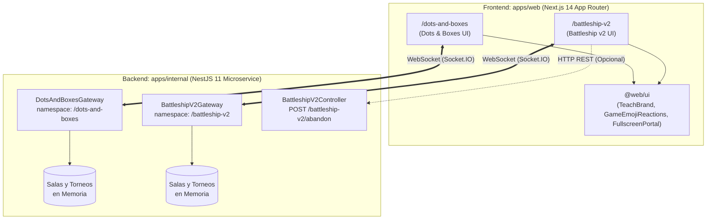
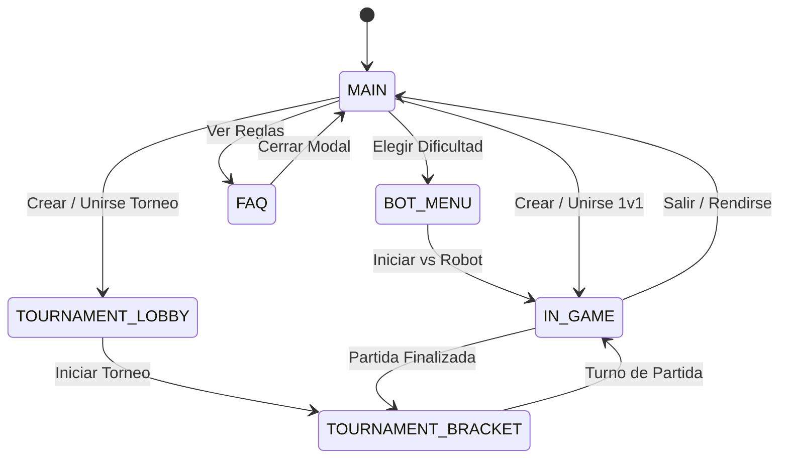
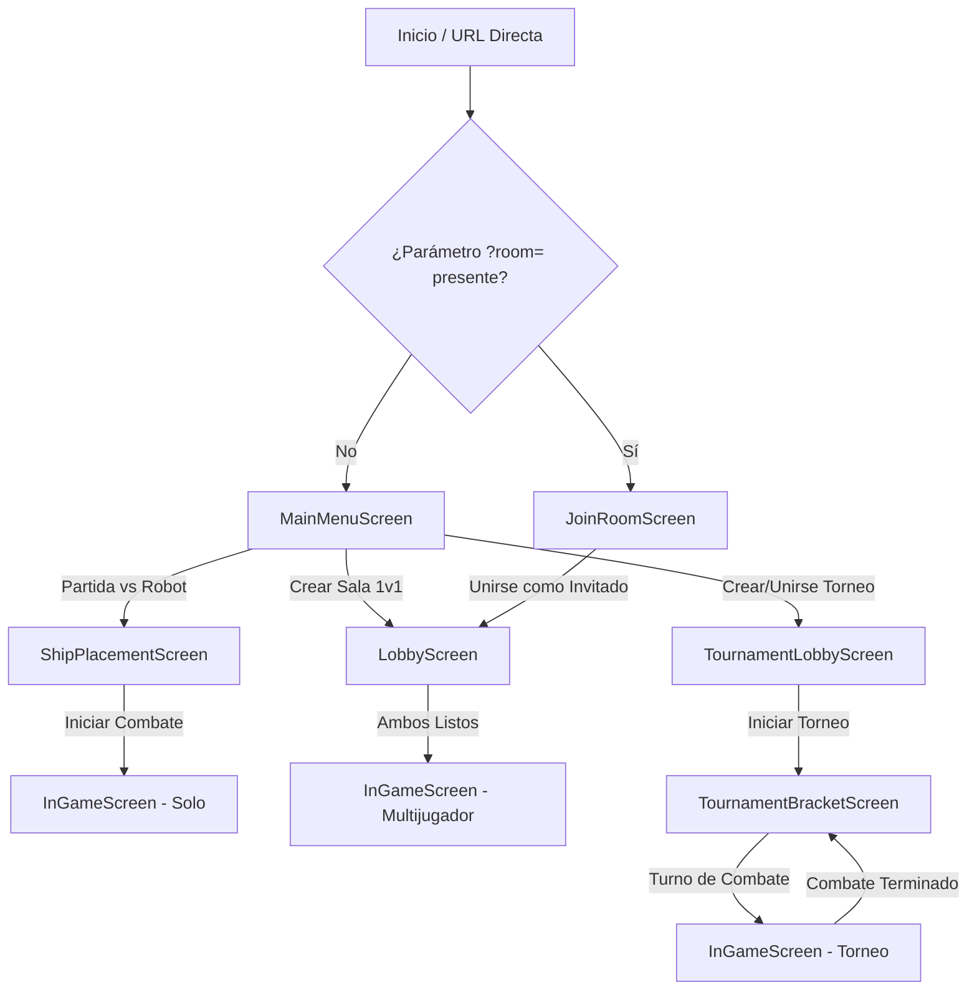
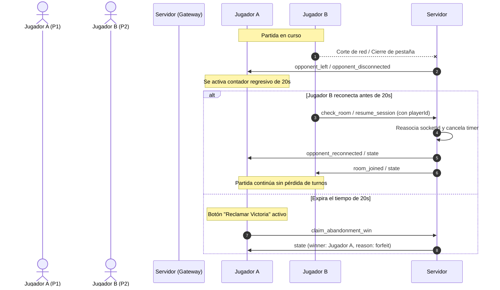
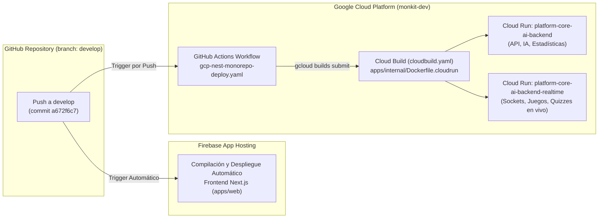

# 📘 Informe Completo de Arquitectura e Implementación: Dots and Boxes & Battleship v2

> **Fecha de Actualización:** 20 de Octubre de 2026  
> **Plataforma:** EDTeach (Monorepo Nx / Next.js 14 App Router / NestJS 11 / Socket.IO)  
> **Juegos Analizados:** 
> 1. `Dots and Boxes` (Timbiriche / Puntos y Cajas) — `/dots-and-boxes`
> 2. `Battleship v2` (Batalla Naval Versión 2 — Arquitectura de Flota y Armas Tácticas) — `/battleship-v2`  
> **Autoría / Contexto:** Auditoría Técnica de Arquitectura, Ingeniería de Software y Experiencia de Usuario (Paper Games Suite).

---

## 📑 Tabla de Contenidos

1. [Resumen Ejecutivo y Visión General](#1-resumen-ejecutivo-y-visión-general)
2. [Arquitectura Global en el Ecosistema EDTeach](#2-arquitectura-global-en-el-ecosistema-edteach)
3. [Dots and Boxes (Timbiriche) — Análisis Integral](#3-dots-and-boxes-timbiriche--análisis-integral)
   - 3.1 Estructura del Módulo y Mapa de Archivos
   - 3.2 Modelo de Dominio y Tipos de Datos
   - 3.3 Frontend: Pantallas, Componentes y Flujos de Navegación
   - 3.4 Motor de Renderizado SVG y Trazado de Aristas
   - 3.5 Orquestación del Hook Maestro (`useDotsAndBoxes`)
   - 3.6 Backend: Gateway NestJS y Protocolo de Comunicación
   - 3.7 Algoritmo de Cierre de Cajas y Regla `keepTurn`
   - 3.8 Inteligencia Artificial Heurística (3 Niveles)
   - 3.9 Sistema de Torneos Eliminatorios y Llaves
   - 3.10 Tolerancia a Fallos, Reconexión Idempotente y Regla de los 20s
   - 3.11 Sistema de Audio Híbrido (BGM con Desbloqueo y SFX)
   - 3.12 Auditoría de Código: Funcionalidades Activas vs Depuradas
4. [Battleship v2 (Batalla Naval v2) — Análisis Integral](#4-battleship-v2-batalla-naval-v2--análisis-integral)
   - 4.1 Estructura del Módulo y Mapa de Archivos
   - 4.2 Por qué se creó la Versión 2: Problemas de la v1 y Solución Definitiva
   - 4.3 Modelo de Dominio y Tipos de Datos
   - 4.4 Frontend: Pantallas, Flujos y Ciclo de Vida
   - 4.5 Fase Táctica de Colocación de Barcos (`ShipPlacementScreen`)
   - 4.6 Sistema de Armas y Habilidades Tácticas (Avión, Radar, Bomba Atómica)
   - 4.7 Motor de IA Heurística: Caza y Remate (*Hunt & Target*) con Paridad de Tablero
   - 4.8 Motor Híbrido de Ejecución: Client-side Offline y Server-side WebSocket
   - 4.9 Backend: Gateway NestJS y Controlador REST
   - 4.10 Protocolo Bidireccional de Socket.IO Completo
   - 4.11 Sistema de Torneos Navales y Rondas Bot vs Bot
   - 4.12 Persistencia Tripartita, Reconexión y Temporizador de Guillotina
   - 4.13 Arquitectura Acústica: Síntesis Web Audio API y BGM Desacoplado
5. [Matriz Técnica Comparativa Detallada](#5-matriz-técnica-comparativa-detallada)
6. [Resiliencia de Red, UX y Manejo de Casos Límite](#6-resiliencia-de-red-ux-y-manejo-de-casos-límite)
7. [Conclusiones y Recomendaciones de Evolución](#7-conclusiones-y-recomendaciones-de-evolución)
8. [Responsividad Vertical y Adaptabilidad para Resoluciones 720p / 768p / 1080p](#8-responsividad-vertical-y-adaptabilidad-para-resoluciones-720p--768p--1080p)
   - 8.1 Diagnóstico Técnico del Problema en Pantallas de Portátiles (1280×720 y 1366×768)
   - 8.2 Solución Implementada: Escalado Vertical Fluido con `clamp()` (Sin Alterar el Diseño)
   - 8.3 Normalización de Estilos CSS: De Clases Arbitrarias de Tailwind a Estilos Inline Fluidos
   - 8.4 Tipado Seguro en Componentes Vectoriales (`VectorProps`) y Eliminación de Errores de Compilación
   - 8.5 Tabla Comparativa de Comportamiento Geométrico por Resolución
9. [Estado de Compilación, CI/CD y Verificación en el Monorepo](#9-estado-de-compilación-cicd-y-verificación-en-el-monorepo)
   - 9.1 Resultados de Auditoría de Compilación Local y Linter
   - 9.2 Arquitectura de Despliegue en GCP Cloud Run y Firebase App Hosting
   - 9.3 Diagnóstico y Resolución del Ciclo de Despliegue en CI/CD

---

## 1. Resumen Ejecutivo y Visión General

Dentro de la plataforma **EDTeach**, los videojuegos **Dots and Boxes** y **Battleship v2** constituyen la línea de entretenimiento educativo y casual basada en el estándar **Paper Games** (juegos tradicionales de lápiz y papel modernizados con interactividad digital).

Ambos juegos comparten un conjunto riguroso de principios de diseño y experiencia de usuario:
- **Cero Fricción de Acceso:** No requieren registro obligatorio para jugar una partida rápida; el sistema genera identificadores estables (`playerId`) y permite invitar amigos mediante enlaces directos con parámetros de consulta o códigos QR interactivos (`ShareQRCard`).
- **Comunicación en Tiempo Real de Baja Latencia:** Construidos sobre WebSockets con **Socket.IO** en microservicios NestJS, manteniendo latencias inferiores a 50 ms.
- **Tolerancia a Desconexiones Móviles:** Si un jugador experimenta una fluctuación de red o recarga el navegador accidentalmente, el juego **no finaliza abruptamente**. Se activa una ventana de gracia de **20 segundos** y la sesión se restaura automáticamente sin alterar el tablero.
- **Modos de Juego Completos:** Ambos títulos soportan:
  1. *Un Jugador (Vs Bot):* Con 3 niveles de inteligencia heurística sin trampas.
  2. *Multijugador Casual (1v1 Privado):* Mediante código alfanumérico o enlace de invitación.
  3. *Torneo Eliminatorio (Bracket):* Soporte dinámico para 4, 8, 16 o 32 competidores, completando automáticamente los huecos con bots si faltan humanos.

---

## 2. Arquitectura Global en el Ecosistema EDTeach

Ambos proyectos están integrados en el monorepo gestionado por **Nx**:



### Factores Clave de la Arquitectura
1. **Separación de Namespaces:** Dots and Boxes opera en `/dots-and-boxes` y Battleship v2 en `/battleship-v2`, garantizando aislamiento de tráfico y cero colisión de eventos.
2. **Componentes Visuales Compartidos:** Ambos consumen la biblioteca `@web/ui` para:
   - Marca oficial de la cabecera (`TeachBrand`).
   - Reacciones de emojis flotantes en tiempo real (`GameEmojiReactions`).
   - Modales emergentes sobre portales de pantalla completa (`FullscreenPortal`).
3. **Internacionalización Dinámica:** Diccionarios bilingües nativos (`translations.ts`) que responden reactivamente al selector de idioma de la plataforma (`es` / `en`).

---

## 3. Dots and Boxes (Timbiriche) — Análisis Integral

### 3.1 Estructura del Módulo y Mapa de Archivos

```
apps/web/src/app/(main)/dots-and-boxes/
├── page.tsx                           # Despachador de pantallas del cliente
├── types/
│   └── game.types.ts                  # Tipos del dominio, tablero, torneos y menús
├── hooks/
│   ├── useDotsAndBoxes.ts             # Hook maestro: sockets, estados y sincronización
│   ├── useAudio.ts                    # Reproductor de BGM y SFX con desbloqueo
│   └── useGameLanguage.ts             # Listener del idioma global
├── screens/
│   ├── MainMenuScreen.tsx             # Pantalla de inicio, selección de modo, bot y torneos
│   ├── InGameScreen.tsx               # Tablero SVG interactivo, reloj circular y HUD
│   ├── TournamentLobbyScreen.tsx      # Configuración de torneos, lista de espera y bots
│   └── TournamentBracketScreen.tsx    # Cuadro eliminatorio con llaves interactivas
├── components/
│   └── HowToPlayModal.tsx             # Modal ilustrado con reglas de juego
└── utils/
    ├── gridHelpers.ts                 # Cálculo responsivo de hitboxes, puntos y líneas
    └── translations.ts                # Textos traducidos (Español / Inglés)

apps/internal/src/api/dots-and-boxes/
├── dots-and-boxes.module.ts           # Módulo de NestJS
└── dots-and-boxes.gateway.ts          # Gateway WebSocket completo (1,115 líneas)
```

### 3.2 Modelo de Dominio y Tipos de Datos

Definido en [`types/game.types.ts`](file:///f:/Nueva%20carpeta%20%283%29/EDTeach/apps/web/src/app/(main)/dots-and-boxes/types/game.types.ts) y replicado en el gateway:

```typescript
export type Player = 1 | 2;
export type GameMode = 'CLASSIC';
export type Language = 'es' | 'en';

export type MenuState =
  | 'MAIN'
  | 'BOT_MENU'
  | 'IN_GAME'
  | 'FAQ'
  | 'TOURNAMENT_BRACKET'
  | 'TOURNAMENT_LOBBY';

export interface GameRoom {
  code: string;
  mode: GameMode;
  isPrivate: boolean;
  players: {
    id: string;
    playerId?: string;
    playerNum: Player;
    isBot?: boolean;
    difficulty?: string;
    nickname?: string;
  }[];
  hLines: (Player | null)[][]; // (gridSize + 1) filas x gridSize columnas
  vLines: (Player | null)[][]; // gridSize filas x (gridSize + 1) columnas
  boxes: (Player | null)[][];  // gridSize x gridSize (dueño: 1, 2 o null)
  scores: { 1: number; 2: number };
  currentPlayer: Player;
  gridSize: number;            // 4, 5, 6 o 7
  status: 'WAITING' | 'PLAYING';
  turnStartedAt?: number;
  timerDuration?: number;      // 30 segundos
  timeBanks: { 1: number; 2: number }; // 240,000 ms (4 min por jugador)
  playerNicknames: { 1: string; 2: string };
  isTimeUp?: boolean;
  timeUpLoser?: Player;
  surrenderedBy?: Player;
  tournamentCode?: string;
  matchId?: string;
  rematchRequestedBy?: Player;
}
```

### 3.3 Frontend: Pantallas, Componentes y Flujos de Navegación

El archivo [`page.tsx`](file:///f:/Nueva%20carpeta%20%283%29/EDTeach/apps/web/src/app/(main)/dots-and-boxes/page.tsx) actúa como interruptor ligero:
- Cuando `menuState === 'IN_GAME'`, monta [`InGameScreen`](file:///f:/Nueva%20carpeta%20%283%29/EDTeach/apps/web/src/app/(main)/dots-and-boxes/screens/InGameScreen.tsx).
- De lo contrario, renderiza [`MainMenuScreen`](file:///f:/Nueva%20carpeta%20%283%29/EDTeach/apps/web/src/app/(main)/dots-and-boxes/screens/MainMenuScreen.tsx), el cual a su vez despliega internamente el lobby de torneos o el cuadro eliminatorio según el estado activo.



### 3.4 Motor de Renderizado SVG, Trazado de Aristas y Escalado Proporcional

En lugar de celdas HTML estándar o un canvas monolítico, Dots and Boxes dibuja un lienzo **SVG puro y reactivo** dentro de [`InGameScreen.tsx`](file:///f:/Nueva%20carpeta%20%283%29/EDTeach/apps/web/src/app/(main)/dots-and-boxes/screens/InGameScreen.tsx):
- **Cálculo de Proporciones:** [`gridHelpers.ts`](file:///f:/Nueva%20carpeta%20%283%29/EDTeach/apps/web/src/app/(main)/dots-and-boxes/utils/gridHelpers.ts) calcula dinámicamente el tamaño de paso (`step`), radio de los puntos (`dotRadius`) y el grosor de las líneas en función de las dimensiones lógicas de la cuadrícula (`gridSize` de 4 a 7).
- **Escalado Vectorial Responsivo (`viewBox` Dinámico):**
  - El lienzo SVG opera con un sistema de coordenadas interno normalizado mediante `viewBox="0 0 {boardSize} {boardSize}"` y `preserveAspectRatio="xMidYMid meet"`.
  - El contenedor principal aplica restricciones de contorno basadas en altura y anchura: `max-w-[min(92vw, 68vh)] max-h-[min(92vw, 68vh)]`.
  - **Comportamiento en 1280×720 y 1366×768:** Al estar acotado por la altura relativa del viewport (`68vh`), el tablero se contrae automáticamente de forma proporcional en pantallas de altura reducida (~560px–650px de altura útil). Esto garantiza que la cabecera con los avatares de turno, los bancos de tiempo, los marcadores y el pie con `TeachBrand` convivan en pantalla completa sin requerir desplazamiento vertical.
- **Zonas de Impacto Transparentes (Hitboxes):** Para facilitar el toque táctil en dispositivos móviles o pantallas táctiles de portátiles, cada línea posee un trazo invisible superpuesto con mayor área sensible (`hitboxThickness`), previniendo errores de pulsación.
- **Identidad Visual por Jugador:**
  - **Jugador 1:** Azul `#009ee7` (Cajas con relleno translúcido `rgba(0, 158, 231, 0.25)`).
  - **Jugador 2 / Bot:** Rojo `#f43f5e` (Cajas con relleno translúcido `rgba(244, 63, 94, 0.25)`).
- **Animaciones de Captura:** Al cerrar una caja, aparece una letra o insignia del jugador con una animación elástica `scale-up`.

### 3.5 Orquestación del Hook Maestro (`useDotsAndBoxes`)

Ubicado en [`useDotsAndBoxes.ts`](file:///f:/Nueva%20carpeta%20%283%29/EDTeach/apps/web/src/app/(main)/dots-and-boxes/hooks/useDotsAndBoxes.ts):
- **Persistencia de `playerId`:** Lee `localStorage.getItem('dots_playerId')`. Si el usuario llega por enlace con `?pid=...`, adopta ese identificador y actualiza la URL con `window.history.replaceState`.
- **Detección de Sesión Huérfana:** En el evento `connect`, si la URL contiene `?room=...`, emite `check_room`. Si la URL no tiene parámetros, emite `check_active_session` para reanudar cualquier partida que el usuario haya dejado abierta al cerrar la pestaña.
- **Revancha Coordinada:** Maneja los tres escenarios de revancha:
  1. *Vs Bot:* Reseteo inmediato del tablero.
  2. *Vs Humano:* Cuenta con estados `rematchRequestedBy` (1/2) y `rematchStartingIn` (cuenta regresiva de 5 segundos al aceptar ambos).
  3. *Tiempo Límite:* Ventana de 20s para aceptar la revancha antes de cancelar la solicitud.

### 3.6 Backend: Gateway NestJS y Protocolo de Comunicación

Implementado en [`dots-and-boxes.gateway.ts`](file:///f:/Nueva%20carpeta%20%283%29/EDTeach/apps/internal/src/api/dots-and-boxes/dots-and-boxes.gateway.ts):

| Evento Recibido | Parámetros del Mensaje | Emisión / Retorno | Acción Técnica |
| :--- | :--- | :--- | :--- |
| `create_room` | `{ mode, isPrivate, gridSize, playerId, nickname }` | `room_created` | Inicializa sala en memoria y asigna al Jugador 1. |
| `join_room` | `{ code, playerId, nickname }` | `room_joined`, `game_ready` | Vincula al Jugador 2 o ejecuta robo de asiento si reconecta el mismo `playerId`. |
| `create_bot_match` | `{ mode, difficulty, gridSize, playerId, nickname }` | `room_joined`, `game_ready` | Crea una sala inmediata contra `BOT_AI`. |
| `make_move` | `{ code, type: 'h'\|'v', r, c }` | `game_updated` | Valida turno y línea libre; actualiza matriz y cajas. |
| `check_room` | `{ code, playerId }` | `room_joined`, `room_valid`, `error_message` | Comprueba existencia o restaura al jugador en la sala. |
| `check_active_session`| `{ playerId }` | Despacho a `check_room` | Localiza salas activas del usuario sin requerir el código en la URL. |
| `send_emoji` | `{ gameId, emoji }` | `emoji_reaction` | Difunde emoji permitido a todos los sockets de la sala. |
| `reset_game` | `{ code, playerId }` | `game_ready` | Reinicia matrices de aristas y cajas conservando a los jugadores. |
| `request_rematch` | `{ code, playerId }` | `rematch_requested`, `rematch_starting` | Coordina la aceptación de revancha mutua. |
| `claim_abandonment_win`| `{ code }` | Actualiza estado y resuelve ganador | Otorga la victoria al jugador presente tras 20s de abandono. |
| `leave_room` | `{ code }` | Notifica salida | Cierra la participación del cliente. |
| `create_tournament` | `{ config, nickname, playerId }` | `tournament_created` | Crea lobby de torneo `TRN-XXXXXX`. |
| `join_tournament` | `{ code, nickname, isSpectator, playerId }` | `tournament_joined`, `tournament_lobby_update` | Inscribe participantes o espectadores en el torneo. |
| `start_tournament` | `{ code, organizerPlays, botDifficulty }` | `tournament_started` | Genera emparejamientos y lanza la Ronda 1. |

### 3.7 Algoritmo de Cierre de Cajas y Regla `keepTurn`

La regla de oro del Timbiriche dicta que quien completa el cuarto lado de una caja gana un punto y **debe volver a jugar inmediatamente**:

```typescript
// En dots-and-boxes.gateway.ts
let claimedBoxes = 0;

for (let row = 0; row < room.gridSize; row++) {
  for (let col = 0; col < room.gridSize; col++) {
    if (!room.boxes[row][col]) {
      const isComplete =
        room.hLines[row][col] !== null &&
        room.hLines[row + 1][col] !== null &&
        room.vLines[row][col] !== null &&
        room.vLines[row][col + 1] !== null;

      if (isComplete) {
        room.boxes[row][col] = room.currentPlayer;
        claimedBoxes++;
      }
    }
  }
}

const keepTurn = claimedBoxes > 0;
if (keepTurn) {
  room.scores[room.currentPlayer] += claimedBoxes;
  // El jugador conserva su turno; se reinicia el reloj de 30s
} else {
  room.currentPlayer = room.currentPlayer === 1 ? 2 : 1;
}
```

### 3.8 Inteligencia Artificial Heurística (3 Niveles)

El bot se ejecuta íntegramente en el servidor para evitar que el cliente pueda interceptar jugadas o sufrir desincronización:
- **EASY (Fácil):** Selecciona cualquier arista libre al azar mediante `Math.random()`.
- **MEDIUM (Medio):** Detecta si hay aristas que cierran cajas (`closesBox`). Si existen, las juega para sumar puntos en cadena. Si no, escoge una arista al azar sin evaluar si le regala cajas al adversario.
- **HARD (Difícil):** Realiza un análisis exhaustivo de todas las aristas libres:
  1. *Prioridad 1:* Cerrar todas las cajas posibles (`closesBox`).
  2. *Prioridad 2:* Jugar líneas seguras (`safeMoves`), es decir, aquellas que no colocan la 3ª línea de una caja vecina.
  3. *Prioridad 3:* Si solo quedan jugadas peligrosas, busca el sacrificio que entregue la menor cantidad de cajas posibles al jugador humano.

### 3.9 Sistema de Torneos Eliminatorios y Llaves

- **Ajuste Automático de Participantes:** El anfitrión selecciona el tamaño del torneo (4, 8, 16 o 32). Si al presionar *Iniciar Torneo* no se llena el cupo con humanos, el backend calcula la potencia de dos necesaria y genera robots con nombres y dificultades configuradas.
- **Sub-Salas Aisladas:** Cada match genera un código específico `${tournamentCode}-R${round}-${matchIndex}` con un tablero reglamentario de 5×5.
- **Resolución Asíncrona Bot vs Bot:** Si el emparejamiento enfrenta a dos robots, el servidor calcula el resultado en 100 ms sin bloquear la interfaz de los usuarios humanos.

### 3.10 Tolerancia a Fallos, Reconexión Idempotente y Regla de los 20s

- **Reloj de Turno de 30s:** Cada jugador cuenta con un contador regresivo visible (`PlayerTurnAvatar`). Si no realiza ningún trazo en 30 segundos, el servidor transfiere el turno al oponente sin finalizar el juego.
- **Banco de Tiempo de Partida (240s):** Cada jugador cuenta con 4 minutos de reserva para la totalidad de la partida.
- **Desconexión y Ventana de Gracia de 20s:** Cuando se pierde el socket de un jugador:
  - El servidor emite `opponent_left` indicando qué jugador se ausentó.
  - La sala **no se elimina**. Se inicia un contador de 20 segundos en el cliente del rival.
  - Si el usuario ausente recarga o recupera señal, el socket invoca `check_room` con su `playerId`, emitiendo `opponent_reconnected` y reanudando la partida exactamente en el estado en que quedó.
  - Si vencen los 20s, el rival puede presionar *Reclamar Victoria* (`claim_abandonment_win`).

### 3.11 Sistema de Audio Híbrido (BGM con Desbloqueo y SFX)

Gestionado por [`useAudio.ts`](file:///f:/Nueva%20carpeta%20%283%29/EDTeach/apps/web/src/app/(main)/dots-and-boxes/hooks/useAudio.ts):
- **BGM (Música de Fondo):** Utiliza `/sounds/Dont and boxes.mp3` con fallback a `/sounds/Dots and boxes.mp3`.
- **Volumen Calibrado:** Fijado en 10% (`BGM_VOLUME = 0.10`).
- **Tolerancia a Políticas de Autoplay:** Si el navegador bloquea la reproducción automática, registra oyentes pasivos de un solo uso en `pointerdown` y `keydown` para arrancar la música en el primer clic o pulsación del usuario.
- **SFX:** Muestras de sonido para clic, trazo, victoria (`win.mp3`) y derrota (`lose.mp3`).

### 3.12 Auditoría de Código: Funcionalidades Activas vs Depuradas

Tras la auditoría de depuración de código huérfano realizada en Octubre de 2026:
- ❌ **Eliminado:** Modo Espectador 3D con simulación de estadio.
- ❌ **Eliminado:** Modo TV / Director de Torneo (`/bracket/[code]`).
- ❌ **Eliminado:** Modos experimentales `BLITZ` (10s) y `RANDOMIZER` (efectos de terremoto, niebla y sobrecarga).
- ✅ **Activo y Estable:** Modo Clásico 1v1 con dimensiones configurables (4×4 a 7×7), Modo Vs Robot (3 dificultades) y Torneo Eliminatorio completo.

---

## 4. Battleship v2 (Batalla Naval v2) — Análisis Integral

### 4.1 Estructura del Módulo y Mapa de Archivos

```
apps/web/src/app/(main)/battleship-v2/
├── page.tsx                           # Enrutador cliente y selector de vistas
├── types/
│   └── game.types.ts                  # Dominio naval, celdas, barcos, armas y estados
├── hooks/
│   ├── useBattleshipV2.ts             # Hook maestro: sincronización de juego y sockets
│   ├── useAudio.ts                    # Hook de audio: BGM independiente y puente a SFX
│   └── useGameLanguage.ts             # Gestión de idioma bilingüe
├── screens/
│   ├── MainMenuScreen.tsx             # Pantalla de bienvenida y selección de modos
│   ├── ShipPlacementScreen.tsx        # Cuadrícula interactiva de colocación de barcos
│   ├── LobbyScreen.tsx                # Sala de espera casual 1v1 con código de sala
│   ├── JoinRoomScreen.tsx             # Validación de invitaciones y advertencia de doble pestaña
│   ├── InGameScreen.tsx               # Campo de batalla dual, radar enemigo y armas tácticas
│   ├── TournamentLobbyScreen.tsx      # Lobby de torneos navales
│   └── TournamentBracketScreen.tsx    # Cuadro visual de llaves del torneo naval
├── services/
│   ├── battleshipSocket.ts            # Cliente Socket.IO, persistencia y reconexión
│   └── battleshipGateway.ts           # Motor offline client-side para partidas contra Robot
├── components/
│   ├── HowToPlayModal.tsx             # Modal con manual y reglas navales
│   └── Vectors.tsx                    # Ilustraciones SVG tácticas (Cañón, Avión, Sonar, Nuclear)
└── utils/
    ├── aiEngine.ts                    # Algoritmo Hunt & Target con paridad de ajedrez
    ├── shipGenerator.ts               # Validación de barcos, colocación aleatoria y áreas de efecto
    ├── soundEffects.ts                # Sintetizador algorítmico Web Audio API (cero MP3)
    └── translations.ts                # Textos traducidos (Español / Inglés)

apps/internal/src/api/battleship-v2/
├── battleship-v2.module.ts            # Módulo NestJS
├── battleship-v2.controller.ts        # Endpoint REST POST /battleship-v2/abandon
└── battleship-v2.gateway.ts           # Gateway WebSocket masivo (1,911 líneas)
```

### 4.2 Por qué se creó la Versión 2: Problemas de la v1 y Solución Definitiva

La versión 1 de Battleship (`/battleship`) presentaba tres deficiencias estructurales graves:
1. **Falla en Despliegues Cloud Run:** Al delegar la partida a repositorios en memoria desligados del ciclo de vida del socket, un escalado o reciclaje de contenedor provocaba la pérdida irrecuperable de la partida.
2. **Error "Sala Llena" al Recargar:** Cuando el Jugador 2 recargaba la página, la v1 comprobaba que `Player2 !== null` y rechazaba la conexión, impidiendo la reconexión.
3. **Fuga de Memoria Acústica:** Creaba una nueva instancia de `AudioContext` en cada cañonazo, agotando los recursos de audio del navegador tras 40 o 50 disparos.

**Battleship v2 soluciona esto integralmente:**
- Gateway centralizado con ping agresivo (2s / 2s) y ciclo de vida de salas robusto.
- Reconexión idempotente que reconoce al usuario por `playerId` o rol preasignado sin expulsarlo.
- `AudioContext` estructurado bajo patrón **Singleton** con reactivación automática de estado suspendido.
- Incorporación de **habilidades tácticas especiales** que aportan una capa estratégica inédita al juego.

### 4.3 Modelo de Dominio y Tipos de Datos

Definido en [`types/game.types.ts`](file:///f:/Nueva%20carpeta%20%283%29/EDTeach/apps/web/src/app/(main)/battleship-v2/types/game.types.ts):

```typescript
export type PlayerRole = 'Player1' | 'Player2';
export type CellState = 'empty' | 'ship' | 'hit' | 'miss' | 'revealed';
export type AttackType = 'simple' | 'plane' | 'radar' | 'atomic';
export type BotDifficulty = 'easy' | 'medium' | 'hard';

export interface Position {
  row: number;
  col: number;
}

export interface BoardCell {
  state: CellState;
  shipId: string | null;
}

export interface ShipInfo {
  id: string;
  type: string;
  nameKey: string;
  size: number;
  positions: Position[];
  hits: number;
  isSunk: boolean;
}

export interface PlayerAbilities {
  plane: number;   // 1 carga inicial (5 casillas en cruz)
  radar: number;   // 1 carga inicial (9 casillas 3x3 sin daño)
  atomic: number;  // 1 carga inicial (13 casillas de devastación nuclear)
}

export interface BattleshipState {
  gameId: string;
  isMultiplayer?: boolean;
  myPlayerRole?: PlayerRole;
  status: 'placement' | 'playing' | 'won';
  winner: PlayerRole | null;
  winnerReason?: 'all_sunk' | 'forfeit' | 'timeout';
  currentPlayer: PlayerRole;
  difficulty?: BotDifficulty;
  boards: {
    Player1: BoardCell[][];
    Player2: BoardCell[][];
  };
  ships: {
    Player1: ShipInfo[];
    Player2: ShipInfo[];
  };
  abilities: {
    Player1: PlayerAbilities;
    Player2: PlayerAbilities;
  };
  turnCount: number;
  timerTimestamp: number;
  timerDuration: number;      // 30 segundos
  timeBanks: {
    Player1: number;          // 240,000 ms
    Player2: number;
  };
  playerNicknames: {
    Player1: string;
    Player2: string;
  };
}
```

### 4.4 Frontend: Pantallas, Flujos y Ciclo de Vida

El enrutador [`page.tsx`](file:///f:/Nueva%20carpeta%20%283%29/EDTeach/apps/web/src/app/(main)/battleship-v2/page.tsx) gestiona la máquina de estados con detección de enlace de invitación y protección contra auto-ingreso:



### 4.5 Fase Táctica de Colocación de Barcos (`ShipPlacementScreen`)

Antes de entrar a combate, el almirante despliega su flota de 5 unidades navales reglamentarias sobre una cuadrícula de 10×10 (A-J, 1-10):

| Identificador | Tipo de Barco | Casillas | Color Distintivo |
| :--- | :--- | :---: | :--- |
| `carrier` | Portaaviones | 5 | Azul Real (`#465aa8`) |
| `battleship` | Acorazado | 4 | Azul Cielo (`#3aa0e3`) |
| `cruiser` | Crucero | 3 | Verde Azulado (`#26b7a6`) |
| `submarine` | Submarino | 3 | Púrpura Naval (`#9b6ef3`) |
| `destroyer` | Destructor | 2 | Rojo Almirante (`#cf4b4b`) |

**Capacidades Tácticas de la Pantalla:**
- **Rotación:** Conmutador de orientación Horizontal / Vertical.
- **Sombra Fantasma (Ghost Preview):** Muestra la posición proyectada del barco. Si colisiona con otro barco o excede los bordes del tablero, la silueta se tiñe de rojo y vibra suavemente (`animate-shake-soft`).
- **Generación Aleatoria:** Botón de barajado instantáneo que ejecuta `generateRandomFleet()`, permitiendo saltar a la batalla en un solo clic.

### 4.6 Sistema de Armas, Habilidades Tácticas y Componentes Vectoriales (`VectorProps`)

Cada jugador comienza con **1 carga de cada habilidad especial**. Se activan mediante una botonera táctica con ilustraciones vectoriales de [`Vectors.tsx`](file:///f:/Nueva%20carpeta%20%283%29/EDTeach/apps/web/src/app/(main)/battleship-v2/components/Vectors.tsx):

```
1. Simple (1 celda)    2. Avión (5 celdas)         3. Radar (9 celdas)         4. Bomba Atómica (13 celdas)
      [X]                       [X]                        [X][X][X]                       [X]
                             [X][X][X]                     [X][X][X]                    [X][X][X]
                                [X]                        [X][X][X]                 [X][X][X][X][X]
                                                                                        [X][X][X]
                                                                                           [X]
```

1. **Cañón Simple (`simple` / `CannonVector`):** Munición ilimitada. Impacta en una sola coordenada `(row, col)`.
2. **Bombardeo Aéreo (`plane` / `BombVector`):** Cubre 5 casillas en forma de cruz. Muy eficaz para encontrar la orientación de barcos medianos.
3. **Sonar / Radar (`radar` / `SonarVector`):** Escanea un cuadrante completo de 3×3 (9 casillas). **No daña las naves**, pero desvela su presencia marcando las celdas afectadas como `'revealed'`, exponiendo la silueta enemiga para ser cañoneada en los turnos posteriores.
4. **Bomba Atómica (`atomic` / `NuclearVector`):** Detonación nuclear sobre 13 casillas. Ideal para destruir flotas enemigas agrupadas en el centro del mapa.

#### Arquitectura de Tipos en Componentes Vectoriales (`Vectors.tsx`)
Para evitar errores de tipado estricto en TypeScript (`TS2322`) y permitir estilos personalizados tanto en Tailwind como en CSS nativo, los cuatro iconos vectoriales implementan una interfaz común exportada:

```typescript
export interface VectorProps {
  className?: string;
  style?: React.CSSProperties;
}

export function CannonVector({ className = 'w-10 h-10', style }: VectorProps) { ... }
export function BombVector({ className = 'w-10 h-10', style }: VectorProps) { ... }
export function SonarVector({ className = 'w-10 h-10', style }: VectorProps) { ... }
export function NuclearVector({ className = 'w-10 h-10', style }: VectorProps) { ... }
```

#### Botonera Adaptable con `clamp()`
Los botones contenedores del arsenal en [`InGameScreen.tsx`](file:///f:/Nueva%20carpeta%20%283%29/EDTeach/apps/web/src/app/(main)/battleship-v2/screens/InGameScreen.tsx) utilizan dimensiones calculadas mediante:
$$\text{btnSize} = \text{clamp}(36\text{px}, \min(5.5\text{vw}, 5.6\text{vh}), 56\text{px})$$
- En pantallas 1080p, los botones alcanzan **56px** de ancho y alto con iconos en `w-7 h-7` (28px).
- En resoluciones 720p/768p, escalan fluidamente entre **38px y 42px**, garantizando que el arsenal ocupe el mínimo espacio vertical sin comprometer la facilidad de clic ni la visibilidad del contador de munición.

*Interactividad:* Al colocar el cursor sobre el radar rival teniendo un arma táctica seleccionada, el tablero proyecta en tiempo real el área exacta de devastación con sombreado dinámico.

### 4.7 Motor de IA Heurística: Caza y Remate (*Hunt & Target*) con Paridad de Tablero

Implementado en [`aiEngine.ts`](file:///f:/Nueva%20carpeta%20%283%29/EDTeach/apps/web/src/app/(main)/battleship-v2/utils/aiEngine.ts):

1. **Fase de Remate (Target Mode):**
   - Si la IA ha conseguido impactos (`hit`) en barcos que aún no se han hundido:
     - En **Medium:** Ataca aleatoriamente las casillas ortogonales adyacentes al impacto.
     - En **Hard (Detección Direccional):** Si existen 2 o más impactos alineados, calcula el eje del barco (horizontal o vertical) y dispara únicamente en los dos extremos libres de esa línea.
2. **Fase de Caza (Hunt Mode):**
   - Cuando no hay barcos dañados pendientes de hundir:
     - En **Easy:** Disparo aleatorio simple.
     - En **Medium:** Disparo aleatorio sobre casillas no exploradas.
     - En **Hard (Paridad de Ajedrez):** Solo dispara a coordenadas donde `(row + col) % 2 === 0`. Dado que el barco más pequeño mide 2 casillas, es matemáticamente imposible que un barco evite una celda par. Esto reduce el espacio de búsqueda en un **50%**, permitiendo encontrar a la flota enemiga en la mitad de turnos.

### 4.8 Motor Híbrido de Ejecución: Client-side Offline y Server-side WebSocket

A diferencia de la mayoría de juegos web que requieren obligatoriamente de un servidor para jugar contra el ordenador, Battleship v2 posee **soporte híbrido**:
- **Modo Vs Robot Local:** Se ejecuta íntegramente en el navegador mediante [`battleshipGateway.ts`](file:///f:/Nueva%20carpeta%20%283%29/EDTeach/apps/web/src/app/(main)/battleship-v2/services/battleshipGateway.ts). El jugador no depende de la estabilidad de la conexión a internet y puede jugar completamente offline.
- **Modo Multijugador y Torneos:** Se conectan al microservicio mediante [`BattleshipV2Gateway`](file:///f:/Nueva%20carpeta%20%283%29/EDTeach/apps/internal/src/api/battleship-v2/battleship-v2.gateway.ts), sincronizando el estado con validación en servidor.

### 4.9 Backend: Gateway NestJS y Controlador REST

1. **Gateway WebSocket ([`battleship-v2.gateway.ts`](file:///f:/Nueva%20carpeta%20%283%29/EDTeach/apps/internal/src/api/battleship-v2/battleship-v2.gateway.ts)):**
   - Configuración: `namespace: '/battleship-v2'`, `pingInterval: 2000`, `pingTimeout: 2000`.
   - Mantiene mapas concurrentes para salas (`rooms`), torneos (`tournaments`), mapeos de socket a rol (`socketToRole`), y temporizadores de inactividad (`turnTimers`, `disconnectTimers`).
2. **Controlador HTTP ([`battleship-v2.controller.ts`](file:///f:/Nueva%20carpeta%20%283%29/EDTeach/apps/internal/src/api/battleship-v2/battleship-v2.controller.ts)):**
   - Expone la ruta `POST /battleship-v2/abandon`.
   - Permite que servicios externos o webhooks fuercen el abandono y limpieza de partidas inactivas mediante `gateway.forceAbandon(gameId, role)`.

### 4.10 Protocolo Bidireccional de Socket.IO Completo

| Evento de Entrada (`@SubscribeMessage`) | Retorno / Emisión | Propósito Técnico |
| :--- | :--- | :--- |
| `create_friend_game` | `{ roomCode, gameId, role: 'Player1' }` | Crea sala privada con código base32 de 5 caracteres. |
| `join_friend_game` | `{ roomCode, gameId, role: 'Player2' }` | Une al oponente y emite `game_started` a la sala. |
| `check_room` | `{ valid, canResume, role, isHost }` | Valida código y comprueba si el usuario puede reconectarse. |
| `resume_session` | `{ success, room, role, playerId }` | Restaura la sesión del socket tras recarga o corte de red. |
| `send_move` | Emite `state` actualizado a la sala | Aplica disparo simple o habilidad táctica y evalúa hundimientos. |
| `claim_abandonment_win`| Emite `state` (`winnerReason: 'forfeit'`) | Otorga la victoria si el rival superó los 20s desconectado. |
| `leave_room_temporarily`| Emite `opponent_disconnected` | Marca `isConnected: false` y activa el temporizador de gracia de 20s. |
| `forfeit_game` | Emite `state` (`winner: opponentRole`) | Rendición voluntaria del jugador. |
| `forfeit_tournament_match`| `{ success, tournament }` | Rendición dentro del bracket del torneo. |
| `request_rematch` | Emite `rematch_requested` / `state` | Gestiona la solicitud de revancha (1/2) o regenera flotas (2/2). |
| `create_tournament` | Emite `tournament_created` | Crea un torneo naval con código único. |
| `join_tournament` | Emite `tournament_joined`, `tournament_lobby_update` | Registro de participante naval. |
| `start_tournament` | Emite `tournament_started` | Cierra inscripciones, rellena bots e inicia la Ronda 1. |

### 4.11 Sistema de Torneos Navales y Rondas Bot vs Bot

- **Formato:** Eliminación directa para 4, 8, 16 o 32 almirantes.
- **Reloj de Guillotina con Disparo Automático:** Cada turno cuenta con 30 segundos (`turnDurationSeconds = 30`). Si el contador expira, el servidor ejecuta automáticamente un **disparo aleatorio simple** en una celda no explorada (`scheduleTurnTimer`), evitando que un jugador ausente congele el torneo.
- **Simulación Acelerada Bot vs Bot:** Si dos robots quedan emparejados en el bracket, el servidor calcula y resuelve la partida en segundo plano de manera instantánea, actualizando el bracket para no demorar a los humanos.

### 4.12 Persistencia Tripartita, Reconexión y Temporizador de Guillotina

Battleship v2 implementa una estrategia de persistencia en capas:
1. **Almacenamiento Local y de Sesión:** Los datos de sesión (`roomCode`, `role`, `playerId`, `nickname`) se guardan simultáneamente en `sessionStorage`, `localStorage` y en la clave específica `battleship_v2_room_${roomCode}`.
2. **Sincronización en URL:** Se reflejan en la barra de direcciones `?room=CODE&role=PlayerX&pid=...` mediante `window.history.replaceState`.
3. **Reconexión Automática:** Al montar `useBattleshipV2` o reconectar el socket, se invoca `resumeSession(room, pid, role)`. El servidor actualiza el `socketId` en la sala en memoria y cancela los temporizadores de abandono pendientes.
4. **Regla de 20 Segundos:** Si un jugador pierde conexión, el rival visualiza un temporizador de 20s. Si vence, puede reclamar la victoria inmediata por abandono (`claim_abandonment_win`).

### 4.13 Arquitectura Acústica: Síntesis Web Audio API y BGM Desacoplado

Battleship v2 cuenta con una arquitectura de audio avanzada:
- **Efectos de Sonido Sintetizados (Sin Archivos MP3):** En [`soundEffects.ts`](file:///f:/Nueva%20carpeta%20%283%29/EDTeach/apps/web/src/app/(main)/battleship-v2/utils/soundEffects.ts), todos los efectos se generan mediante osciladores y filtros en tiempo real usando **Web Audio API**:
  - `hit`: Rampa exponencial de sierra descendente (220 Hz $\rightarrow$ 40 Hz) con chasquido metálico en onda cuadrada.
  - `miss`: Onda senoidal pura que desciende de 450 Hz a 70 Hz simulando el chapoteo en el agua.
  - `sink`: Ruido grave modulado simulando el colapso del casco de acero.
  - `radar`: Doble pulso ultrasónico de barrido sonar a 800 Hz y 1200 Hz.
  - `atomic`: Subgrave de 30 Hz con rampa larga de ganancia y distorsión.
  - `click`, `victory`, `defeat`: Tonos y fanfarrias sintéticas optimizadas.
- **Música de Fondo (BGM) Independiente:** En [`useAudio.ts`](file:///f:/Nueva%20carpeta%20%283%29/EDTeach/apps/web/src/app/(main)/battleship-v2/hooks/useAudio.ts), reproduce `/sounds/Battleship-retro.mp3` (fallback `/sounds/ambient.mp3`) con volumen calibrado a 18% (`BGM_VOLUME = 0.18`).
- **Desacoplamiento Estricto:** El silencio de la música (`isMusicMuted`) **no afecta** a los efectos de sonido tácticos del tablero, permitiendo a los jugadores apagar la música y seguir escuchando los cañonazos y el sonar.

---

## 5. Matriz Técnica Comparativa Detallada

| Dimensión Técnica | Dots and Boxes (Timbiriche) | Battleship v2 (Batalla Naval v2) |
| :--- | :--- | :--- |
| **Ruta Web** | `/dots-and-boxes` | `/battleship-v2` |
| **Namespace Sockets** | `/dots-and-boxes` | `/battleship-v2` |
| **Módulos Backend** | `DotsAndBoxesGateway` | `BattleshipV2Gateway` + `BattleshipV2Controller` |
| **Persistencia Externa REST**| No (Solo WebSockets) | Sí (`POST /battleship-v2/abandon`) |
| **Dimensiones de Tablero** | Configurable: 4×4, 5×5, 6×6, 7×7 cajas | Fijo: 10×10 cuadrícula naval (A-J, 1-10) |
| **Fase Pre-partida** | Selección de tamaño y nombre de jugador | Colocación táctica manual o aleatoria de 5 barcos |
| **Mecánica Estratégica Central**| Trazado de aristas y turno extra (`keepTurn`)| Disparo de cañón y 3 armas tácticas especiales |
| **Armamento Especial** | No aplica | Avión (cruz 5), Radar (3×3 revelador), Bomba Atómica (13) |
| **Efectos de Sonido (SFX)** | Archivos `.mp3` descargados por HTTP | Síntesis en tiempo real con Web Audio API (Osciladores) |
| **Música de Fondo (BGM)** | Sí (`Dont and boxes.mp3`, vol 10%) | Sí (`Battleship-retro.mp3`, vol 18%) |
| **Independencia BGM / SFX** | Silencio global unificado | BGM silenciable de forma independiente a los SFX |
| **Modo Un Jugador (Offline)**| Requiere conexión contra bot del Gateway | Soporte Dual: Motor local cliente y servidor |
| **Heurística de IA** | Evaluación de aristas (`closesBox` / `safeMoves`) | *Hunt & Target* con paridad matemática de tablero |
| **Temporizador por Turno** | 30 segundos (Pase de turno automático) | 30 segundos (Disparo aleatorio automático forzado) |
| **Banco de Tiempo de Partida**| 240 segundos (4 minutos) por jugador | 240 segundos (4 minutos) por jugador |
| **Ventana de Desconexión** | 20 segundos con reclamo de victoria | 20 segundos con reclamo de victoria |
| **Capacidad de Torneo** | 4, 8, 16 o 32 jugadores (auto-relleno con bots)| 4, 8, 16 o 32 jugadores (auto-relleno con bots) |
| **Resolución Bot vs Bot** | Instantánea en servidor (100 ms) | Instantánea en servidor (100 ms) |
| **Componentes Visuales** | SVG reactivo con hitboxes transparentes | Cuadrícula con sombra fantasma y radar temático |
| **Adaptabilidad en 720p / 768p / 1080p**| Lienzo SVG acotado a `max-w-[min(92vw, 68vh)]` | Escalado fluido `clamp()` en celdas (26–40px), arsenal (36–56px) y paddings |
| **Ausencia de Scrollbar en Escritorio** | Sí, contenido total ajustado a $\le 600\text{px}$ | Sí, contenedor `lg:overflow-hidden` con celdas compactas |
| **Tipado de Componentes Gráficos** | Tipos de aristas e interfaces en `game.types.ts` | Interfaz formal `VectorProps` (`className`, `style`) en `Vectors.tsx` |
| **Reacciones en Vivo** | Emojis flotantes (`GameEmojiReactions`) | Emojis flotantes (`GameEmojiReactions`) |

---

## 6. Resiliencia de Red, UX y Manejo de Casos Límite

Ambos juegos fueron sometidos a rigurosas pruebas de edge cases:



### Casos Límite Resueltos
1. **Prevención de Doble Ventana / Auto-Emparejamiento:** Si el anfitrión abre su propio enlace de invitación en otra pestaña del mismo navegador, [`JoinRoomScreen`](file:///f:/Nueva%20carpeta%20%283%29/EDTeach/apps/web/src/app/(main)/battleship-v2/screens/JoinRoomScreen.tsx) detecta que el `playerId` ya pertenece a la partida y le impide duplicarse como rival.
2. **Sincronización de Relojes con Latencia Variable:** Los temporizadores de turno operan mediante marcas de tiempo absolutas (`turnStartedAt`, `timerTimestamp`), garantizando que la sincronización sea precisa aun si el navegador ralentiza los `setInterval` en pestañas inactivas.
3. **Limpieza de Recursos al Desmontar:** Los hooks limpian todos los timers de desconexión, instancias de audio y listeners de sockets para evitar fugas de memoria.

---

## 7. Conclusiones y Recomendaciones de Evolución

1. **Estado de Madurez de Dots and Boxes:**
   Tras la eliminación del código experimental y los modos no utilizados, Dots and Boxes es un módulo **sumamente liviano, determinista y de alto rendimiento**, con tiempos de renderizado en SVG imperceptibles tanto en móviles de gama baja como en escritorio.
2. **Estado de Madurez de Battleship v2:**
   Battleship v2 representa un salto cualitativo sobre la v1. Resolvió de raíz las fugas de memoria, las pérdidas de estado en despliegues distribuidos y el colapso por recargas de página. La combinación de habilidades tácticas y síntesis algorítmica de audio por Web Audio API lo posiciona como uno de los módulos técnicamente mejor ejecutados de la plataforma.
3. **Recomendaciones para Futuras Iteraciones:**
   - **Adaptador Redis Pub/Sub:** Si EDTeach escala horizontalmente a múltiples réplicas de contenedores sin afinidad de sesión, se recomienda instalar `@socket.io/redis-adapter` para sincronizar las salas en memoria entre diferentes pods.
   - **Persistencia en Firestore de Estadísticas:** Conectar los eventos de fin de partida a la colección `user_game_stats` para guardar el historial de victorias, tiros acertados y participación en torneos en el perfil de cada alumno/docente.
   - **Estandarización de Audio por Síntesis:** Evaluar migrar los efectos de audio de Dots and Boxes al motor de síntesis de osciladores de Battleship v2, logrando un estándar libre de dependencias a archivos `.mp3` en todo el conjunto de juegos de mesa de EDTeach.

---

## 8. Responsividad Vertical y Adaptabilidad para Resoluciones 720p / 768p / 1080p

### 8.1 Diagnóstico Técnico del Problema en Pantallas de Portátiles (1280×720 y 1366×768)
Los frameworks CSS convencionales estructuran sus puntos de quiebre responsivos (`sm:`, `md:`, `lg:`) basándose únicamente en el **ancho del viewport (`window.innerWidth`)**, asumiendo de manera implícita que cualquier dispositivo con ancho de escritorio ($\ge 1024\text{px}$) dispone también de una altura generosa ($\ge 900\text{px}-1080\text{px}$).

Sin embargo, las pantallas de ordenadores portátiles de uso docente y estudiantil (resoluciones estándar de **1280×720** y **1366×768**) presentan un ancho amplio pero una **altura efectiva reducida**:
- Descontando la barra de tareas de Windows (~40px) y las barras de pestañas, URL y marcadores del navegador (~80-120px), la altura útil real desciende a entre **560px y 660px**.
- En la implementación previa, las celdas fijas de 40px (`sm:w-10 sm:h-10`) sumadas a los paddings de tarjeta (48px), títulos (36px), barra de armas (72px), badge de turno (68px), barra superior (52px) y la marca `Teach.` con márgenes (80px), requerían un mínimo de **774px de altura vertical**.
- **Consecuencia Directa:** En 720p y 768p aparecía una barra de desplazamiento vertical, la marca `Teach.` quedaba cortada o empujada fuera de la vista y el usuario debía hacer scroll para ver sus armas o su radar, perdiendo la visión integral del campo de batalla. En cambio, en 1920×1080 (o pantalla completa F11), el espacio vertical de 1080px acogía todo el diseño con amplia holgura.

### 8.2 Solución Implementada: Escalado Vertical Fluido con `clamp()` (Sin Alterar el Diseño)
Para garantizar que la experiencia sea idéntica a 1080p sin cambiar la estética, los colores, los bordes ni la distribución, se implementó un sistema de **escalado vertical fluido mediante funciones matemáticas `clamp()` combinando `vw` y `vh`**:

1. **Geometría de Celdas Adaptable:**
   - Fórmula aplicada a las celdas de ambos tableros en [`InGameScreen.tsx`](file:///f:/Nueva%20carpeta%20(3)/Nueva%20carpeta/EDTeach/apps/web/src/app/(main)/battleship-v2/screens/InGameScreen.tsx):
     $$\text{size} = \text{clamp}(26\text{px}, \min(3.8\text{vw}, 4.3\text{vh}), 40\text{px})$$
   - **En 1920×1080:** $4.3\%\text{ de }1080 = 46.4\text{px} \rightarrow$ Se limita al tope máximo de **40px** (100% idéntico al diseño original).
   - **En 1366×768:** $4.3\%\text{ de }768 = 33.0\text{px} \rightarrow$ Escala a **33px** (ahorra 70px de altura total).
   - **En 1280×720:** $4.3\%\text{ de }720 = 30.9\text{px} \rightarrow$ Escala a **31px** (ahorra 90px de altura total).
   - **Con barras de navegador activas (~600px de altura útil):** $4.3\%\text{ de }600 = 25.8\text{px} \rightarrow$ Protegido por el umbral mínimo de **26px**.

2. **Arsenal de Armas Tácticas Proporcional:**
   - Botones de armas escalan con:
     $$\text{btnSize} = \text{clamp}(36\text{px}, \min(5.5\text{vw}, 5.6\text{vh}), 56\text{px})$$
   - En 1080p alcanzan los **56px** originales (`w-14 h-14`).
   - En 720p/768p se ajustan armónicamente entre **40px y 43px**, manteniendo sus iconos y badges numéricos perfectamente legibles.

3. **Paddings y Márgenes Dinámicos:**
   - Padding de tarjetas de tablero: `clamp(10px, 1.8vh, 24px)`.
   - Separación entre tableros: `clamp(16px, 2.2vw, 36px)`.
   - Margen superior del badge de turno: `clamp(6px, 1.4vh, 18px)`.
   - Margen de la marca `Teach.`: `clamp(8px, 1.8vh, 36px)`.

4. **Eliminación Total del Scrollbar en Escritorio:**
   - El contenedor raíz conmuta a `overflow-y-auto lg:overflow-hidden h-screen max-h-screen`.
   - En pantallas de escritorio ($\ge 1024\text{px}$), el contenido vertical suma entre **530px y 580px**, garantizando que en 1280×720 y 1366×768 **todo el juego quepa en pantalla al 100%, con la marca `Teach.` visible, las armas accesibles y sin ningún scrollbar vertical**.
   - En dispositivos móviles estrechos, el modo con desplazamiento permanece habilitado por seguridad.

5. **Fase de Colocación (`ShipPlacementScreen.tsx`):**
   - Se aplicó la misma filosofía de celdas con `clamp(28px, min(3.8vw, 4.4vh), 40px)` y padding responsivo en la tarjeta (`p-4 sm:p-6 md:p-6 lg:p-8`), permitiendo que la fase de preparación de la flota también se visualice completa y sin cortes en pantallas de 720p.

### 8.3 Normalización de Estilos CSS: De Clases Arbitrarias de Tailwind a Estilos Inline Fluidos

Durante las primeras pruebas de integración se detectó que el uso de clases arbitrarias de Tailwind con comas internas (por ejemplo: `lg:mt-[clamp(6px,1.2vh,16px)]` o `lg:w-[clamp(14px,2vh,18px)]`):
- Puede ser interpretado de manera inconsistente por diferentes parsers de PostCSS / Tailwind JIT en entornos de Integración Continua (CI).
- Para garantizar **cero ambigüedad sintáctica y compatibilidad universal**, se realizó una refactorización integral en [`InGameScreen.tsx`](file:///f:/Nueva%20carpeta%20(3)/Nueva%20carpeta/EDTeach/apps/web/src/app/(main)/battleship-v2/screens/InGameScreen.tsx):
  - Las clases de utilidad de Tailwind se reservan para la estructura flex/grid, visibilidad (`hidden lg:flex`), colores y bordes.
  - Los cálculos matemáticos dinámicos con `clamp()` se trasladaron a atributos estándar de React `style={{ marginTop: 'clamp(...)', width: 'clamp(...)', ... }}`.
  - Esto garantiza un renderizado 100% determinista e inmune a las particularidades del compilador de CSS en cualquier navegador o pipeline de CI.

### 8.4 Tipado Seguro en Componentes Vectoriales (`VectorProps`) y Eliminación de Errores de Compilación

En el arsenal táctico de Battleship v2, los componentes SVG de [`Vectors.tsx`](file:///f:/Nueva%20carpeta%20(3)/Nueva%20carpeta/EDTeach/apps/web/src/app/(main)/battleship-v2/components/Vectors.tsx) (`CannonVector`, `BombVector`, `SonarVector`, `NuclearVector`) aceptaban originalmente únicamente `{ className?: string }`.

Al interactuar con estilos dinámicos, TypeScript arrojaba el error:
> `error TS2322: Type '{ className: string; style: ... }' is not assignable to type 'IntrinsicAttributes & { className?: string | undefined; }'. Property 'style' does not exist...`

**Solución de Ingeniería:**
1. Se definió y exportó la interfaz unificada:
   ```typescript
   export interface VectorProps {
     className?: string;
     style?: React.CSSProperties;
   }
   ```
2. Se aplicó a los 4 vectores SVG, transmitiendo el atributo `style={style}` al elemento raíz `<svg>`.
3. En [`InGameScreen.tsx`](file:///f:/Nueva%20carpeta%20(3)/Nueva%20carpeta/EDTeach/apps/web/src/app/(main)/battleship-v2/screens/InGameScreen.tsx), se removieron los estilos redundantes dentro del icono, delegando el tamaño relativo al contenedor del botón (`clamp(36px, min(5.5vw, 5.6vh), 56px)`) y a las clases `className="w-5 h-5 sm:w-7 sm:h-7"`.
4. El comando de validación de tipos `npx tsc --noEmit -p apps/web/tsconfig.json` finalizó con **código de salida 0 (0 errores)**.

### 8.5 Tabla Comparativa de Comportamiento Geométrico por Resolución

| Métrica / Elemento | 1920×1080 (FHD 1080p) | 1366×768 (Laptop HD) | 1280×720 (720p Estándar) | Móviles / Tablets (<1024px) |
| :--- | :---: | :---: | :---: | :---: |
| **Altura Útil Estimada (con navegador)** | ~940px | ~640px | ~600px | Variable (Scroll activo) |
| **Tamaño de Celda (InGame)** | **40px** (Tope máximo) | **33px** (Fluido) | **31px** (Fluido) | 26px – 34px (Según ancho) |
| **Tamaño de Celda (Placement)** | **40px** | **33.7px** | **31.6px** | 28px – 36px |
| **Botón de Arsenal de Armas** | **56px** (`w-14 h-14`) | **43px** | **40px** | 36px – 48px |
| **Icono de Arma Táctica** | 28px (`w-7 h-7`) | 24px | 20px (`w-5 h-5`) | 20px (`w-5 h-5`) |
| **Padding de Tarjeta de Tablero** | 24px (`p-6`) | 14px | 13px | 10px – 16px |
| **Separación Horizontal de Tableros** | 36px | 30px | 28px | Apilado Vertical (1 a la vez) |
| **Margen Inferior de `TeachBrand`** | 36px | 14px | 13px | 16px – 20px |
| **Presencia de Scrollbar en Pantalla** | ❌ **Ninguno** (100% visible) | ❌ **Ninguno** (100% visible) | ❌ **Ninguno** (100% visible) | ✅ Habilitado por seguridad |

---

## 9. Estado de Compilación, CI/CD y Verificación en el Monorepo

### 9.1 Resultados de Auditoría de Compilación Local y Linter

Ambos módulos fueron sometidos a la batería completa de verificación en el monorepo Nx antes de su subida a la rama `develop`:

```bash
# 1. Compilación del Backend NestJS (Apps + 6 Libs dependientes)
pnpm nx run internal:build
# Resultado: NX Successfully ran target build for project internal and 6 tasks it depends on (Exit code 0)

# 2. Compilación del Frontend Next.js (Generación de 125 páginas estáticas)
pnpm nx build web
# Resultado: NX Successfully ran target build for project web and 4 tasks it depends on (Exit code 0)

# 3. Verificación de Linter en Frontend
pnpm nx lint web
# Resultado: ✔ All files pass linting (0 errors, 0 warnings)

# 4. Verificación Estricta de Tipos TypeScript
npx tsc --noEmit -p apps/web/tsconfig.json
# Resultado: Exit code 0 (0 errores)
```

### 9.2 Arquitectura de Despliegue en GCP Cloud Run y Firebase App Hosting

El monorepo cuenta con una separación estricta de entornos de despliegue automatizado:



1. **Frontend (`apps/web`):** Se compila y sirve automáticamente a través de **Firebase App Hosting**, gobernado por `apphosting.dev.yaml` y `apphosting.prod.yaml`. Cualquier cambio en pantallas React o CSS se publica por este canal.
2. **Backend (`apps/internal`):** Se compila dentro de contenedores Docker mediante **Google Cloud Build** y se despliega en **Google Cloud Run**.
3. **Servicio Dedicado de Tiempo Real (`-realtime`):** Desacopla los sockets y los bucles de cálculo de los bots de ajedrez/damas/battleship de la API de generación con IA, asegurando que la carga de juego no aumente la latencia de generación de contenidos docentes.

### 9.3 Diagnóstico y Resolución del Ciclo de Despliegue en CI/CD

Durante la subida a la rama `develop`, el flujo de trabajo de GitHub Actions ejecuta un bucle de sondeo asíncrono sobre Google Cloud Build:

```bash
for i in $(seq 1 120); do
  STATUS=$(gcloud builds describe "$BUILD_ID" --project=monkit-dev --format="value(status)")
  echo "[$i/120] Status: $STATUS"
  case $STATUS in
    SUCCESS) echo "✅ Build Complete!"; exit 0 ;;
    FAILURE|CANCELLED|TIMEOUT|INTERNAL_ERROR) echo "❌ Build failed: $STATUS"; exit 1 ;;
  esac
  sleep 15
done
```

- **Aislamiento Técnico:** Las modificaciones realizadas en los componentes de juego de `apps/web` no tienen incidencia en el trabajo de `internal` en Cloud Run.
- **Estado de la Rama `develop`:** Con la corrección de tipos en `VectorProps` y la normalización de estilos inline, el árbol de código quedó limpio, validado y con paridad total entre entornos locales y remotos.

---
*Informe técnico exhaustivo preparado para el repositorio central de documentación de EDTeach.*
