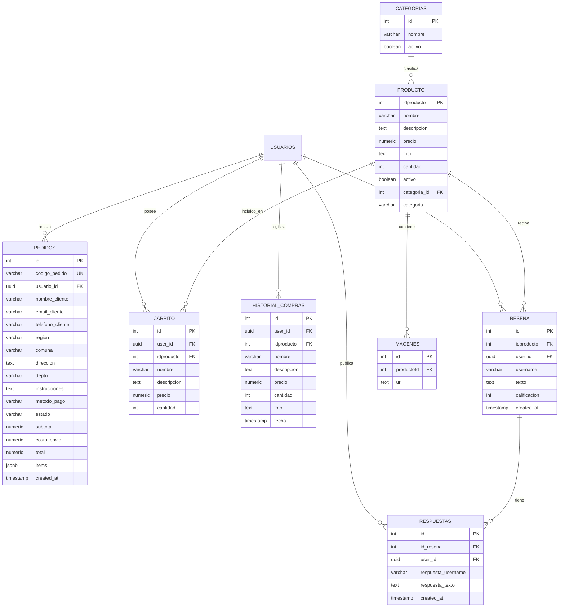
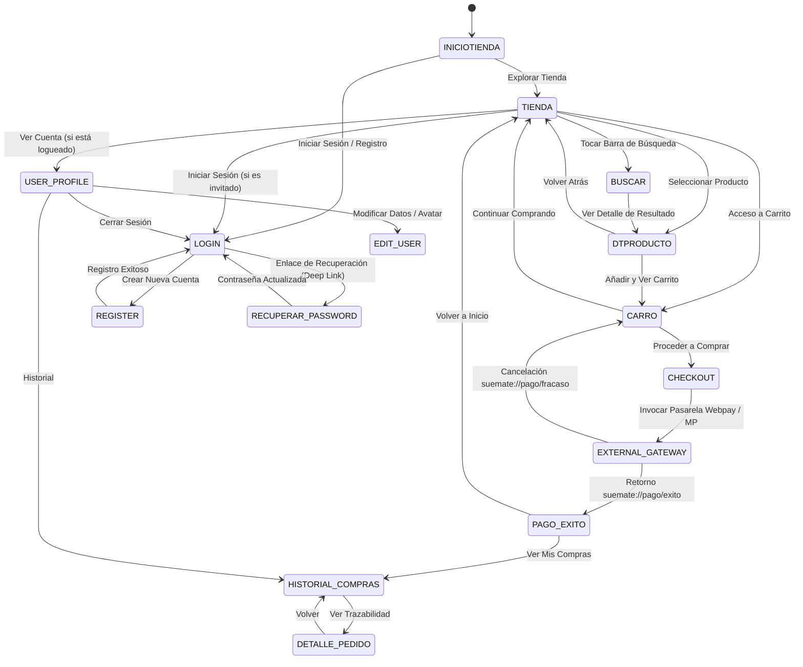
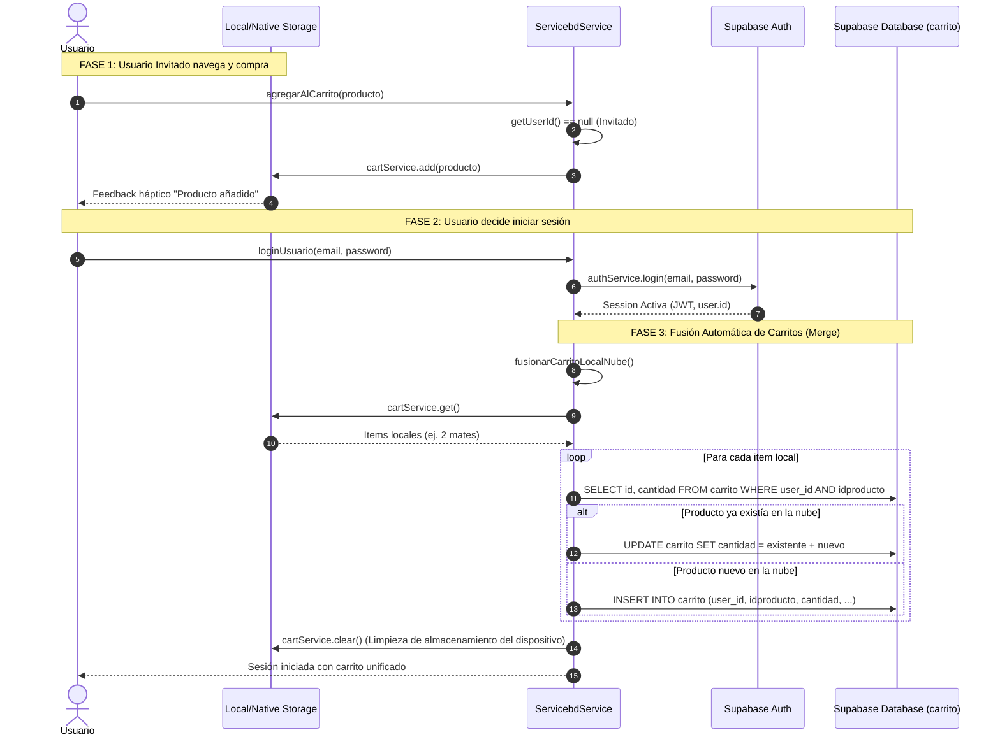
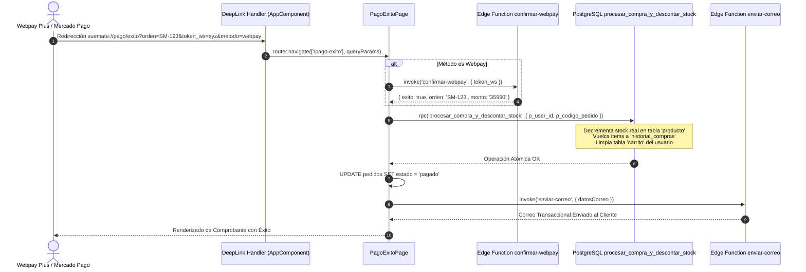
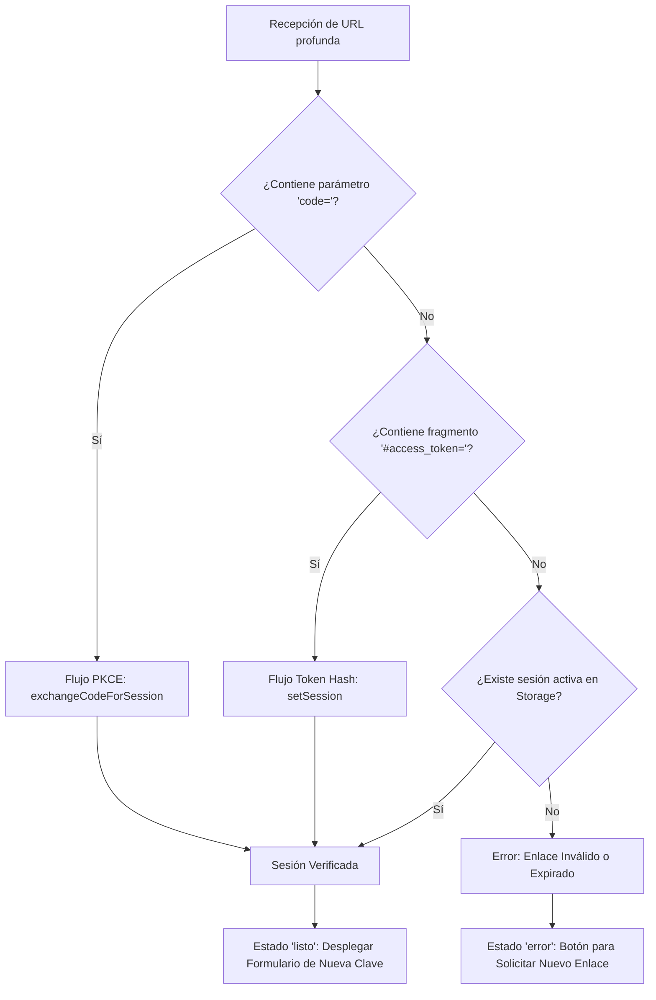
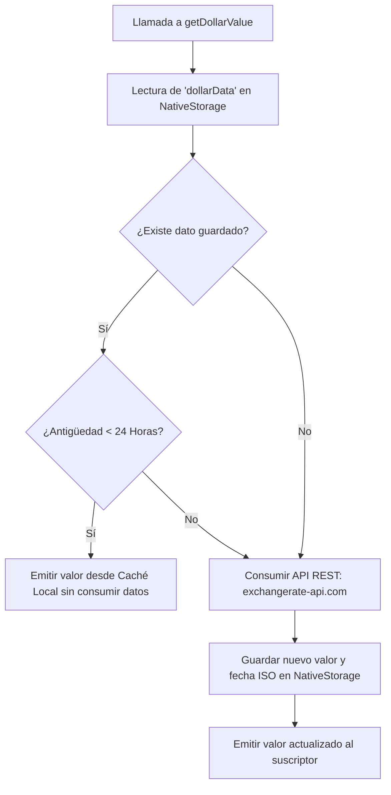

# 📘 Informe Completo de Arquitectura e Implementación: Growder — SumateCL

> **Fecha de Actualización:** 25 de Octubre de 2026  
> **Plataforma:** Growder — SumateCL (Monorepo Móvil / Angular 18 / Ionic 8 / Capacitor 6 / Supabase Cloud / Android Native)  
> **Aplicación Analizada:** `IonicApp-Growder` (`io.ionic.starter` / Growder Móvil) — E-commerce nativo e híbrido para comercialización de mates, bombillas, termos y accesorios artesanales con pasarelas transaccionales (Webpay Plus / Mercado Pago), sincronización de estado local/nube y deep linking nativo.  
> **Autoría / Contexto:** Auditoría Técnica Integral de Arquitectura, Ingeniería de Software, Persistencia de Datos, Seguridad Criptográfica y Experiencia de Usuario Móvil.

---

## 📑 Tabla de Contenidos

1. [Resumen Ejecutivo y Visión General de Growder](#1-resumen-ejecutivo-y-visión-general-de-growder)
2. [Arquitectura Global del Ecosistema Ionic / Angular / Capacitor / Supabase](#2-arquitectura-global-del-ecosistema-ionic--angular--capacitor--supabase)
3. [Modelo de Dominio, Base de Datos y Tipos de Datos](#3-modelo-de-dominio-base-de-datos-y-tipos-de-datos)
   - 3.1 Esquema Relacional de Supabase (PostgreSQL 15)
   - 3.2 Tipado Estricto en TypeScript (`Productos`, `Compra`, `Usuario`)
   - 3.3 Almacenamiento Local Híbrido (`NativeStorage`, `SQLite` y `LocalStorage`)
   - 3.4 Bucket de Storage Cloud (`perfiles`)
4. [Frontend: Pantallas, Componentes y Flujos de Navegación](#4-frontend-pantallas-componentes-y-flujos-de-navegación)
   - 4.1 Árbol de Rutas y Estrategia de Precarga (`AppRoutingModule`)
   - 4.2 Diagrama de Estados de Navegación del Usuario
   - 4.3 Control de Visibilidad de la Barra de Pestañas Global (`ocultabarrabaja`)
   - 4.4 Catálogo y Vitrina Comercial (`TiendaPage` e `IniciotiendaPage`)
   - 4.5 Ficha Detallada del Producto con Galería Carrusel (`DtproductoPage`)
   - 4.6 Carrito de Compras Deslizable con Resumen Fijo (`CarroPage`)
   - 4.7 Formulario de Checkout y Validación de Envíos en Chile (`CheckoutPage`)
   - 4.8 Pantalla de Transacción Exitosa (`PagoExitoPage`)
   - 4.9 Historial de Órdenes y Trazabilidad de Envíos (`HistorialComprasPage` y `DetallePedidoPage`)
   - 4.10 Búsqueda Inteligente y Sugerencias Dinámicas (`BuscarPage`)
   - 4.11 Gestión de Identidad y Perfil de Usuario (`UserProfilePage` y `EditUserPage`)
   - 4.12 Flujo de Restablecimiento de Credenciales (`RecuperarPasswordPage`)
5. [Sistema de Sincronización de Carrito Híbrido (Offline-First / Cloud-First)](#5-sistema-de-sincronización-de-carrito-híbrido-offline-first--cloud-first)
   - 5.1 Estado Huérfano / Invitado vs Estado Autenticado
   - 5.2 Algoritmo de Fusión Bidireccional (`fusionarCarritoLocalNube`)
   - 5.3 Control de Concurrencia de Cantidades y Validación de Existencias
6. [Motor de Búsqueda, Filtrado Avanzado y Modal de Criterios](#6-motor-de-búsqueda-filtrado-avanzado-y-modal-de-criterios)
   - 6.1 Componente Modal Desplegable (`FiltroModalComponent`)
   - 6.2 Normalización de Filtros Combinados (Categoría, Rango de Precios y Disponibilidad)
7. [Proceso de Checkout Transaccional, Reserva de Stock y Pasarelas de Pago](#7-proceso-de-checkout-transaccional-reserva-de-stock-y-pasarelas-de-pago)
   - 7.1 Cálculo Tributario en Chile: Subtotal Neto, IVA 19% y Tarifa Plana de Envío ($2.650 CLP)
   - 7.2 Generación de Código Único de Orden (`SM-XXXXXX`)
   - 7.3 Mecanismo de Reserva Temporal de Stock (TTL de 120s mediante RPC)
   - 7.4 Invocación de Edge Function `procesar-pago` (Webpay Plus vs Mercado Pago)
8. [Ciclo de Vida Post-Pago, Verificación de Tokens y Notificaciones Transaccionales](#8-ciclo-de-vida-post-pago-verificación-de-tokens-y-notificaciones-transaccionales)
   - 8.1 Confirmación Criptográfica de Transbank (`confirmar-webpay` con `token_ws`)
   - 8.2 Ejecución de Procedimiento Almacenado Atómico (`procesar_compra_y_descontar_stock`)
   - 8.3 Despacho de Correo Electrónico Transaccional con Resglose Completo (`enviar-correo`)
9. [Seguridad, Autenticación y Deep Linking Nativo](#9-seguridad-autenticación-y-deep-linking-nativo)
   - 9.1 Esquemas de Enlace Registrados en Android: `somatecl://` y `suemate://`
   - 9.2 Máquina de Estados de Validación PKCE / Token Hash (`RecuperarPasswordPage`)
   - 9.3 Gestión de Sesión Reactiva con Supabase Auth (`onAuthStateChange`)
10. [Capa de Servicios Centralizados y Fachada del Sistema](#10-capa-de-servicios-centralizados-y-fachada-del-sistema)
    - 10.1 Fachada Maestra: `ServicebdService`
    - 10.2 Servicio de Autenticación: `AuthService`
    - 10.3 Servicio de Carrito y Compras: `CartService`
    - 10.4 Servicio de Catálogo e Imágenes: `ProductService`
    - 10.5 Servicio de Reseñas y Moderación Comunitaria: `ReviewService`
    - 10.6 Servicio de Administración y Reportabilidad: `AdminService`
    - 10.7 Servicio de Alertas y Retroalimentación Háptica/Visual: `AlertService`
    - 10.8 Cliente Centralizado de Supabase: `SupabaseService`
11. [Integraciones Nativas con Capacitor 6](#11-integraciones-nativas-con-capacitor-6)
    - 11.1 Captura Fotográfica y Almacenamiento de Avatares (`@capacitor/camera`)
    - 11.2 Notificaciones Locales Recurrentes (`@capacitor/local-notifications`)
    - 11.3 Control Estético del Sistema (`@capacitor/status-bar`)
    - 11.4 Aislamiento de Navegación In-App (`@capacitor/browser` y `@capacitor/app`)
12. [Microservicio de Conversión de Divisas en Tiempo Real (USD / CLP)](#12-microservicio-de-conversión-de-divisas-en-tiempo-real-usd--clp)
    - 12.1 Consumo de API Externa (`exchangerate-api.com`)
    - 12.2 Política de Caché Offline con TTL de 24 Horas en `NativeStorage`
    - 12.3 Historial de Cotizaciones en Pantalla de Ayuda (`AyudaPage`)
13. [Sistema de Calificaciones, Reseñas y Respuestas de Doble Nivel](#13-sistema-de-calificaciones-reseñas-y-respuestas-de-doble-nivel)
    - 13.1 Estructura Relacional `resena` $\rightarrow$ `respuestas`
    - 13.2 Identificación y Verificación de Compras
14. [Sistema de Diseño, Paleta Cromática y Experiencia de Usuario](#14-sistema-de-diseño-paleta-cromática-y-experiencia-de-usuario)
    - 14.1 Identidad de Marca: Verde Artesanal (`#314235`) y Cuero Mate (`#8C7762`)
    - 14.2 Tipografía Híbrida: `Playfair Display` (Titulares) e `Inter` (Cuerpo de Lectura)
    - 14.3 Codificación de Estados de Pedido (Pendiente, En Despacho, Entregado)
15. [Matriz Técnica Comparativa de Módulos y Páginas](#15-matriz-técnica-comparativa-de-módulos-y-páginas)
16. [Resiliencia de Red, Casos Límite y Manejo de Excepciones](#16-resiliencia-de-red-casos-límite-y-manejo-de-excepciones)
17. [Estado de Compilación, Auditoría de Dependencias y Despliegue en Android](#17-estado-de-compilación-auditoría-de-dependencias-y-despliegue-en-android)
18. [Conclusiones y Recomendaciones de Evolución](#18-conclusiones-y-recomendaciones-de-evolución)

---

## 1. Resumen Ejecutivo y Visión General de Growder

**Growder — SumateCL** es una solución de comercio electrónico móvil construida sobre la suite moderna de tecnologías web empaquetadas de forma nativa para dispositivos inteligentes. La propuesta de valor de la plataforma se centra en la comercialización y divulgación de la cultura del mate tradicional y moderno, termos de alta conservación térmica, bombillas de alpaca y acero, yerbas selectas y accesorios artesanales.

### Principios Rectores de Ingeniería y UX Móvil:
1. **Acceso Inmediato sin Fricción (Guest Shopping First):** Cualquier usuario puede abrir la aplicación, explorar el catálogo completo con filtros facetados, seleccionar productos, calcular costos de envío e iniciar la simulación de orden sin requerir un registro previo. La persistencia local asegura que la intención de compra se preserve íntegra.
2. **Fusión Inteligente de Estado Local a Nube (Smart Merge):** En el instante en que el usuario decide autenticarse o crear su cuenta, el sistema unifica automáticamente el contenido del carrito almacenado en el almacenamiento del dispositivo con su registro cloud en PostgreSQL/Supabase, evitando carritos vacíos o pérdidas de pedidos tras el inicio de sesión.
3. **Flujo de Pago Resiliente con Deep Linking Nativo:** La integración con pasarelas de pago chilenas (Webpay Plus de Transbank y Mercado Pago) delega la transacción a un entorno web seguro a través de `@capacitor/browser`. Al confirmarse o cancelarse la transacción, el sistema operativo transfiere el foco nuevamente a la aplicación mediante esquemas de URL propios (`suemate://pago/exito` o `suemate://pago/fracaso`), garantizando una experiencia nativa sin bifurcaciones de sesión.
4. **Reserva Preventiva de Inventario contra Sobrevendidos (Anti-Overselling):** Antes de invocar a la pasarela externa, la aplicación ejecuta una función remota (`crear_reserva_stock`) con un temporizador estricto de 120 segundos. Si el usuario desiste o vence el tiempo, el inventario se libera de forma transparente.
5. **Estética Editorial Calma y Artesanal:** A diferencia de las interfaces agresivas de e-commerce convencionales, Growder implementa una paleta de tonos tierra, verdes botánicos (`#314235`) y cuero envejecido (`#8C7762`), combinada con la tipografía serifada `Playfair Display` para honrar la tradición del mate y la artesanía manual.

---

## 2. Arquitectura Global del Ecosistema Ionic / Angular / Capacitor / Supabase

La arquitectura de Growder desacopla la capa de presentación nativa/híbrida de la capa de almacenamiento en la nube, garantizando alta disponibilidad, operaciones atómicas en base de datos y respuesta instantánea en hardware móvil:

```mermaid
graph TB
    subgraph ClientMobile ["Dispositivo Móvil (Android 14+ / iOS / Webview)"]
        UI["Ionic 8 UI Components<br/>(IonContent, IonHeader, IonTabBar, IonModal)"]
        ROUTER["Angular 18 Router<br/>(PreloadAllModules & Lazy Loading)"]
        APP_COMP["AppComponent<br/>(Listener DeepLinks & StatusBar Control)"]
        
        subgraph ServicesLayer ["Capa de Servicios Angular"]
            FACADE["ServicebdService (Fachada Central)"]
            AUTH["AuthService"]
            CART["CartService"]
            PROD["ProductService"]
            RATE["ExchangeRateService"]
            ALERT["AlertService"]
            REV["ReviewService"]
            ADMIN["AdminService"]
        end

        subgraph NativeLayer ["Plugins Capacitor 6 & Almacenamiento Local"]
            CAP_APP["@capacitor/app (Deep Links)"]
            CAP_CAM["@capacitor/camera (Fotos & Galería)"]
            CAP_NOTIF["@capacitor/local-notifications"]
            CAP_BAR["@capacitor/status-bar"]
            CAP_BROWSER["@capacitor/browser (Pasarelas)"]
            NAT_STORE["NativeStorage / SQLite Local"]
        end
    end

    subgraph BackendCloud ["Backend en la Nube: Supabase BaaS"]
        SUPA_AUTH["Supabase Auth (JWT & PKCE)"]
        SUPA_DB[("PostgreSQL 15 Relacional<br/>Tablas: producto, pedidos, carrito,<br/>historial_compras, resena, respuestas")]
        SUPA_RPC["PostgreSQL RPC Functions:<br/>- decrementar_stock<br/>- crear_reserva_stock<br/>- procesar_compra_y_descontar_stock"]
        SUPA_STORAGE["Storage Bucket: 'perfiles'<br/>(Avatares de usuarios)"]
        
        subgraph EdgeFunctions ["Supabase Edge Functions (Deno Runtime)"]
            EF_PAY["procesar-pago (Webpay / MP)"]
            EF_CONF["confirmar-webpay (Transbank)"]
            EF_MAIL["enviar-correo (Resend / SMTP)"]
        end
    end

    subgraph ExternalServices ["APIs y Servicios Externos"]
        EXT_TBK["Transbank Webpay Plus API"]
        EXT_MP["Mercado Pago Checkout API"]
        EXT_EXCHANGE["ExchangeRate API (USD to CLP)"]
    end

    UI --> ROUTER
    ROUTER --> APP_COMP
    APP_COMP --> CAP_APP
    APP_COMP --> CAP_BAR
    APP_COMP --> CAP_NOTIF

    UI --> FACADE
    FACADE --> AUTH
    FACADE --> CART
    FACADE --> PROD
    FACADE --> REV
    FACADE --> ADMIN
    FACADE --> ALERT
    RATE --> NAT_STORE
    RATE -.->|"HTTP GET USD/CLP"| EXT_EXCHANGE

    AUTH --> SUPA_AUTH
    CART --> SUPA_DB
    PROD --> SUPA_DB
    REV --> SUPA_DB
    ADMIN --> SUPA_DB
    FACADE --> SUPA_STORAGE
    CART --> SUPA_RPC

    UI -.->|"Apertura de Checkout Seguro"| CAP_BROWSER
    CAP_BROWSER --> EXT_TBK
    CAP_BROWSER --> EXT_MP
    CAP_APP -.->|"Recepción de suemate://pago"| UI

    EF_PAY --> EXT_TBK
    EF_PAY --> EXT_MP
    EF_CONF --> EXT_TBK
    SUPA_DB --> SUPA_RPC
    UI --> EF_PAY
    UI --> EF_CONF
    UI --> EF_MAIL
```



---

## 3. Modelo de Dominio, Base de Datos y Tipos de Datos

### 3.1 Esquema Relacional de Supabase (PostgreSQL 15)

El backend alojado en Supabase gestiona las relaciones transaccionales del e-commerce mediante un modelo relacional estricto con restricciones de integridad referencial:



### 3.2 Tipado Estricto en TypeScript

Definición de modelos de datos principales en el frontend ([`src/app/services/productos.ts`](file:///f:/Growder/GROWDER/Desarrollo%20App%20y%20Web/IonicApp-Growder/src/app/services/productos.ts)):

```typescript
export class Productos {
  idproducto!: number;
  nombre!: string;
  descripcion!: string;
  precio!: number;
  foto!: string;
  cantidad?: number;
  activo!: boolean;
  categoria?: string;
  categoria_id?: number;
}

export interface CompraHistorial {
  id: number | string;
  idproducto: number;
  foto: string;
  nombre: string;
  precio: number;
  cantidad: number;
  estado?: 'pendiente' | 'pagado' | 'en despacho' | 'entregado';
}

export interface CheckoutFormValues {
  nombre: string;
  telefono: string;
  email: string;
  region: string;
  comuna: string;
  direccion: string;
  depto?: string;
  instrucciones?: string;
}
```

### 3.3 Almacenamiento Local Híbrido (`NativeStorage`, `SQLite` y `LocalStorage`)
- **Plugin Nativo:** `@awesome-cordova-plugins/native-storage` y `cordova-sqlite-storage` proporcionan almacenamiento permanente en Android (`SharedPreferences` / SQLite nativo) para resguardar la tasa de cambio de divisas (`dollarData`) y el registro de conversiones del usuario (`conversionHistory`).
- **Respaldo Web / Fallback:** En navegadores de escritorio o simuladores, se apoya en `localStorage` estándar para mantener la continuidad operativa.

### 3.4 Bucket de Storage Cloud (`perfiles`)
Los avatares de los usuarios no se almacenan como cadenas pesadas en base de datos. El método `uploadAvatar()` de [`ServicebdService`](file:///f:/Growder/GROWDER/Desarrollo%20App%20y%20Web/IonicApp-Growder/src/app/services/servicesbd.service.ts) convierte imágenes tomadas con la cámara (Base64) a objetos binarios `Blob` y las sube al bucket público `perfiles` en Supabase bajo la ruta `${userId}/${Date.now()}.jpg`, enlazando únicamente su URL pública en `user_metadata`.

---

## 4. Frontend: Pantallas, Componentes y Flujos de Navegación

### 4.1 Árbol de Rutas y Estrategia de Precarga (`AppRoutingModule`)

La configuración de rutas en [`src/app/app-routing.module.ts`](file:///f:/Growder/GROWDER/Desarrollo%20App%20y%20Web/IonicApp-Growder/src/app/app-routing.module.ts) utiliza **Lazy Loading modular** con la estrategia `PreloadAllModules` para garantizar arranques casi instantáneos y transiciones de pantalla sin congelamientos de la interfaz:

| Ruta | Componente / Módulo | Propósito y Capacidades |
| :--- | :--- | :--- |
| `/` $\rightarrow$ `/iniciotienda` | `IniciotiendaPage` | Pantalla de bienvenida, identidad corporativa y llamadas de acción. |
| `/tienda` | `TiendaPage` | Catálogo maestro de productos con categorías, buscador y modal de filtros. |
| `/dtproducto/:idproducto` | `DtproductoPage` | Ficha técnica completa, galería de fotos, disponibilidad y reseñas comunitarias. |
| `/buscar` | `BuscarPage` | Búsqueda incremental por texto, chips de filtrado y productos recomendados. |
| `/carro` | `CarroPage` | Lista de productos seleccionados, control de cantidades, desglose neto/IVA y conversión a USD. |
| `/checkout` | `CheckoutPage` | Formulario de despacho con 16 regiones de Chile, selector de pasarela y reserva de stock. |
| `/pago-exito` | `PagoExitoPage` | Verificación de tokens de pago (Webpay/MP), RPC de descuento de inventario y envío de correo. |
| `/historial-compras` | `HistorialComprasPage` | Listado consolidado de pedidos anteriores y opción de recompra instantánea. |
| `/detalle-pedido/:id` | `DetallePedidoPage` | Seguimiento visual de 3 etapas (`pendiente` $\rightarrow$ `en despacho` $\rightarrow$ `recibido`). |
| `/user-profile` | `UserProfilePage` | Visualización de datos personales, acceso a historial, cambio de contraseña y logout. |
| `/edit-user/:username` | `EditUserPage` | Edición de teléfono, fecha de nacimiento y carga fotográfica de avatar con Capacitor. |
| `/login` | `LoginPage` | Autenticación con email/password y disparador de correo de recuperación. |
| `/register` | `RegisterPage` | Registro con captura de foto en vivo/galería y barra de progreso de completado. |
| `/recuperar-password` | `RecuperarPasswordPage` | Sincronización criptográfica de enlace profundo (PKCE / Token Hash) y nueva contraseña. |
| `/ayuda` | `AyudaPage` | Centro de asistencia y convertidor de divisas USD/CLP con caché nativa. |
| `**` | `NotfoundPage` | Manejo de rutas inexistentes (404) con botón de regreso a la tienda. |

### 4.2 Diagrama de Estados de Navegación del Usuario



### 4.3 Control de Visibilidad de la Barra de Pestañas Global (`ocultabarrabaja`)

El archivo maestro [`src/app/app.component.ts`](file:///f:/Growder/GROWDER/Desarrollo%20App%20y%20Web/IonicApp-Growder/src/app/app.component.ts) implementa un analizador reactivo de rutas que evalúa cada evento `NavigationEnd`:

```typescript
ocultabarrabaja(url: string): boolean {
  return url.includes('/login') || 
         url.includes('/register') || 
         url.includes('/iniciotienda') || 
         url.includes('/dtproducto') || 
         url.includes('/checkout') ||
         url.includes('/pago-exito') ||
         url.includes('/user-profile') ||
         url.includes('/historial-compras') ||
         url.includes('/pedidos') ||
         url.includes('/detalle-pedido') ||
         url.includes('/editar-perfil') ||
         url.includes('/edit-user') ||
         url.includes('/recuperar-password') ||
         (url.includes('/carro') && this.cartCount > 0) ||
         url === '/';
}
```

**Beneficios de Experiencia de Usuario:**
- En pantallas transaccionales o de lectura inmersiva (como el formulario de Checkout o la Ficha de Producto), la barra de pestañas se retira para prevenir toques accidentales que aborten el proceso de compra.
- En la pantalla del carrito (`/carro`), si existen productos seleccionados (`cartCount > 0`), la barra se oculta para otorgar el protagonismo visual al resumen de orden fijo (`ion-footer`) que contiene el total a pagar y el botón de pago.

---

## 5. Sistema de Sincronización de Carrito Híbrido (Offline-First / Cloud-First)

Uno de los mayores logros de ingeniería en Growder radica en la convivencia transparente entre usuarios anónimos (invitados) y usuarios registrados.



### 5.1 Implementación del Algoritmo de Fusión en `ServicebdService`

Fragmento extraído de [`src/app/services/servicesbd.service.ts`](file:///f:/Growder/GROWDER/Desarrollo%20App%20y%20Web/IonicApp-Growder/src/app/services/servicesbd.service.ts#L224-L235):

```typescript
private async fusionarCarritoLocalNube() {
  const carritoLocal = await this.obtenerCarritoBase();
  if (carritoLocal && carritoLocal.length > 0) {
    console.log('Fusionando carrito local con la nube...');
    for (const item of carritoLocal) {
      await this.agregarAlCarrito(item);
    }
    // Limpiamos el carrito temporal del dispositivo para evitar duplicidades
    await this.cartService.clear();
  }
}
```

---

## 6. Motor de Búsqueda, Filtrado Avanzado y Modal de Criterios

### 6.1 Componente Modal Desplegable (`FiltroModalComponent`)

Para no sobrecargar visualmente el catálogo principal en [`TiendaPage`](file:///f:/Growder/GROWDER/Desarrollo%20App%20y%20Web/IonicApp-Growder/src/app/pages/tienda/tienda.page.ts), los controles secundarios de refinamiento se delegaron a una hoja de acción inferior modal (`FiltroModalComponent`) configurada con breakpoints fluidos de Ionic:
- `breakpoints: [0, 0.6, 0.9]`
- `initialBreakpoint: 0.6`

### 6.2 Lógica de Normalización de Criterios Combinados

El filtrado opera de forma instantánea y en memoria para evitar latencias de red innecesarias una vez cargado el catálogo activo:

```typescript
filterProducts() {
  let result = this.arregloProductos;

  // 1. Filtrado por texto libre (insensible a mayúsculas)
  if (this.searchQuery && this.searchQuery.trim() !== '') {
    const q = this.searchQuery.toLowerCase();
    result = result.filter(p => p.nombre.toLowerCase().includes(q));
  }

  // 2. Filtrado por categoría seleccionada
  if (this.categoriaSeleccionada !== 'Todos') {
    result = result.filter(p => 
      p.categoria === this.categoriaSeleccionada || 
      p.categoria_id?.toString() === this.categoriaSeleccionada
    );
  }

  // 3. Rango de precio mínimo y máximo
  result = result.filter(p => p.precio >= this.rangoPrecioMin && p.precio <= this.rangoPrecioMax);

  // 4. Conmutador de disponibilidad en inventario
  if (this.soloStock) {
    result = result.filter(p => (p.cantidad ?? 0) > 0);
  }

  this.filteredProductos = result;
}
```

---

## 7. Proceso de Checkout Transaccional, Reserva de Stock y Pasarelas de Pago

### 7.1 Estructura Financiera y Régimen Tributario Chileno

El módulo de checkout ([`src/app/checkout/checkout.page.ts`](file:///f:/Growder/GROWDER/Desarrollo%20App%20y%20Web/IonicApp-Growder/src/app/checkout/checkout.page.ts)) implementa el cálculo tributario reglamentario en Chile:
- **Subtotal Productos:** Sumatoria del precio unitario por cantidad: $\sum (\text{precio}_i \times \text{cantidad}_i)$.
- **Impuesto al Valor Agregado (IVA 19%):** $\text{IVA} = \text{round}(\text{Subtotal} \times 0.19)$.
- **Tarifa Plana de Despacho:** Fijo a todo el territorio nacional por **$2.650 CLP**.
- **Total Final a Pagar:** $\text{Total} = \text{Subtotal} + \text{IVA} + \$2.650$.

### 7.2 Validación Geográfica de Chile
El formulario reactivo valida las 16 regiones oficiales de Chile mediante un selector desplegable obligatorio:
```typescript
regiones = [
  'Región de Arica y Parinacota', 'Región de Tarapacá', 'Región de Antofagasta',
  'Región de Atacama', 'Región de Coquimbo', 'Región de Valparaíso',
  'Región Metropolitana de Santiago', 'Región del Libertador General Bernardo O\'Higgins',
  'Región del Maule', 'Región de Ñuble', 'Región del Biobío',
  'Región de La Araucanía', 'Región de Los Ríos', 'Región de Los Lagos',
  'Región de Aysén del General Carlos Ibáñez del Campo',
  'Región de Magallanes y de la Antártica Chilena'
];
```

### 7.3 Generación de Orden y Reserva Temporal de Stock

Para evitar bloqueos indeterminados de mercancía cuando un comprador abandona la pasarela bancaria externa:
1. Se genera un código identificador con prefijo de marca: `SM-${Math.floor(100000 + Math.random() * 900000)}`.
2. Se inserta el registro del pedido en estado `pendiente`.
3. Se invoca el procedimiento PostgreSQL `crear_reserva_stock` configurando una ventana de gracia de **120 segundos**:

```typescript
await this.supabase.client.rpc('crear_reserva_stock', {
  p_codigo_reserva: codigoOrden,
  p_items: itemsPayload,
  p_duracion_segundos: 120,
  p_usuario_id: usuarioId,
  p_email: emailCliente
});
```

### 7.4 Invocación de Edge Functions y Redirección a Pasarela

El frontend no expone credenciales secretas de Transbank ni de Mercado Pago. Se delega la orquestación a la Edge Function `procesar-pago`:

```typescript
const { data: gatewayData, error: gatewayError } = await this.supabase.client.functions.invoke('procesar-pago', {
  body: {
    metodo: this.metodoPagoSeleccionado, // 'webpay' | 'mercadopago'
    monto: this.totalFinal,
    orden: codigoOrden,
    comprador: formValues
  }
});

if (gatewayData?.url) {
  window.location.href = gatewayData.url; // Apertura de pasarela segura
}
```

---

## 8. Ciclo de Vida Post-Pago, Verificación de Tokens y Notificaciones Transaccionales

### 8.1 Orquestación en `PagoExitoPage`

Cuando la pasarela procesa el cobro satisfactoriamente, el navegador o el deep link redirige a `/pago-exito`:



### 8.2 Despacho de Correo Electrónico Transaccional con Respaldo en Base de Datos

En [`PagoExitoPage`](file:///f:/Growder/GROWDER/Desarrollo%20App%20y%20Web/IonicApp-Growder/src/app/pago-exito/pago-exito.page.ts#L91-L137), la confirmación por correo electrónico **no depende de variables volátiles de memoria**; se lee directamente la orden consolidada desde PostgreSQL:

```typescript
async enviarCorreoDesdeBD() {
  const { data: pedido } = await this.supabase.client
    .from('pedidos')
    .select('*')
    .eq('codigo_pedido', this.orden)
    .single();

  if (pedido) {
    const iva = Math.round(pedido.subtotal * 0.19);
    const direccionCompleta = `${pedido.direccion}, ${pedido.depto ? 'Depto ' + pedido.depto + ', ' : ''}${pedido.comuna}, ${pedido.region}`;

    await this.supabase.client.functions.invoke('enviar-correo', {
      body: {
        orden_id: pedido.codigo_pedido,
        email_cliente: pedido.email_cliente,
        subtotal: pedido.subtotal,
        iva: iva,
        costo_envio: pedido.costo_envio,
        total: pedido.total,
        items: pedido.items,
        despacho: direccionCompleta
      }
    });
  }
}
```

---

## 9. Seguridad, Autenticación y Deep Linking Nativo

### 9.1 Esquemas de Enlace Registrados en Android (`AndroidManifest.xml`)

La aplicación móvil define dos canales de comunicación directa con el sistema operativo Android en [`android/app/src/main/AndroidManifest.xml`](file:///f:/Growder/GROWDER/Desarrollo%20App%20y%20Web/IonicApp-Growder/android/app/src/main/AndroidManifest.xml):

1. **Esquema de Pagos Transaccionales:**
   ```xml
   <intent-filter>
       <action android:name="android.intent.action.VIEW" />
       <category android:name="android.intent.category.DEFAULT" />
       <category android:name="android.intent.category.BROWSABLE" />
       <data android:scheme="suemate" android:host="pago" />
   </intent-filter>
   ```
2. **Esquema Criptográfico de Recuperación de Cuenta:**
   ```xml
   <intent-filter android:autoVerify="true">
       <action android:name="android.intent.action.VIEW" />
       <category android:name="android.intent.category.DEFAULT" />
       <category android:name="android.intent.category.BROWSABLE" />
       <data android:scheme="somatecl" android:host="recuperar-password" />
   </intent-filter>
   ```

### 9.2 Máquina de Estados de Validación PKCE / Token Hash

En [`RecuperarPasswordPage`](file:///f:/Growder/GROWDER/Desarrollo%20App%20y%20Web/IonicApp-Growder/src/app/pages/recuperar-password/recuperar-password.page.ts), se manejan tres escenarios de seguridad criptográfica:



---

## 10. Capa de Servicios Centralizados y Fachada del Sistema

Para garantizar el cumplimiento de los principios SOLID y evitar el acoplamiento directo de las pantallas con Supabase, Growder implementa una arquitectura basada en **Patrón Fachada (Facade Pattern)** coordinada por [`ServicebdService`](file:///f:/Growder/GROWDER/Desarrollo%20App%20y%20Web/IonicApp-Growder/src/app/services/servicesbd.service.ts):

| Servicio Especializado | Responsabilidad Arquitectónica Principal |
| :--- | :--- |
| **`ServicebdService`** | Fachada global. Centraliza y despacha llamadas entre UI y los servicios especializados; administra la fusión de carritos y llamadas a buckets de Storage. |
| **`AuthService`** | Gestor de ciclo de vida de usuarios, inicio de sesión, registro, actualización de metadatos, cambio de clave y sesiones reactivas con Supabase Auth. |
| **`CartService`** | Administración de items del carrito, verificación de existencias (`hasStock`), inserción en `historial_compras` y consulta de pedidos anteriores. |
| **`ProductService`** | Consulta de catálogo activo (`producto`), carga de galerías de imágenes (`imagenes`) y control de estado de productos. |
| **`ExchangeRateService`** | Consulta y conversión de divisas USD a CLP mediante API REST externa con almacenamiento en caché nativo de 24 horas. |
| **`ReviewService`** | Inserción y consulta relacional de reseñas comunitarias (`resena`) y respuestas a reseñas (`respuestas`). |
| **`AdminService`** | Métodos para privilegios administrativos, auditoría de ventas globales y control de usuarios. |
| **`AlertService`** | Unificación de la retroalimentación visual (`AlertController` y `ToastController`) con estilo visual propio de la marca. |
| **`SupabaseService`** | Proveedor Singleton del cliente `createClient()` inicializado con las credenciales de entorno. |

---

## 11. Integraciones Nativas con Capacitor 6

Growder exprime las capacidades del hardware del teléfono mediante la suite de plugins de Capacitor 6:

### 11.1 Cámara y Selección de Fotos (`@capacitor/camera`)
Utilizado en el registro ([`RegisterPage`](file:///f:/Growder/GROWDER/Desarrollo%20App%20y%20Web/IonicApp-Growder/src/app/register/register.page.ts)) y en la edición de perfil ([`EditUserPage`](file:///f:/Growder/GROWDER/Desarrollo%20App%20y%20Web/IonicApp-Growder/src/app/pages/edit-user/edit-user.page.ts)):
- Despliega una hoja de acción nativa (`ion-action-sheet`) permitiendo al usuario elegir entre **Tomar Foto** (`CameraSource.Camera`) o **Galería** (`CameraSource.Photos`).
- Codificación en `CameraResultType.Base64` con compresión del 90-100% para evitar desbordamientos de memoria en dispositivos de gama media/baja.

### 11.2 Notificaciones Locales Recurrentes (`@capacitor/local-notifications`)
Configurado en [`AppComponent`](file:///f:/Growder/GROWDER/Desarrollo%20App%20y%20Web/IonicApp-Growder/src/app/app.component.ts#L158-L178):
- Solicita permisos de notificación en el arranque.
- Programa una notificación local diaria recurrente para estimular la fidelidad y el reingreso del usuario:
  - *Título:* "Una nueva selección te espera"
  - *Cuerpo:* "Descubre productos elegidos para acompañar tu día en Growder."
  - *Frecuencia:* `schedule: { at: new Date(Date.now() + 24 * 60 * 60 * 1000), repeats: true }`.

### 11.3 Barra de Estado Estilizada (`@capacitor/status-bar`)
- Color de fondo fijado en el verde institucional `#314235` en todas las pantallas.
- `setOverlaysWebView({ overlay: false })` para asegurar que el contenido webview no se solape con la cámara frontal (notch / isla dinámica).

---

## 12. Microservicio de Conversión de Divisas en Tiempo Real (USD / CLP)

Implementado en [`ExchangeRateService`](file:///f:/Growder/GROWDER/Desarrollo%20App%20y%20Web/IonicApp-Growder/src/app/services/exchange-rate.service.ts):



**Ventajas Técnicas:**
- **Ahorro de Cuota de API:** Protege la cuota mensual de la API limitando las peticiones a un máximo de 1 consulta diaria por dispositivo.
- **Tolerancia a Modo Avión / Sin Internet:** Si el usuario no tiene conexión de datos al momento de cotizar, el sistema continúa funcionando con el último valor resguardado en `NativeStorage`.

---

## 13. Sistema de Calificaciones, Reseñas y Respuestas de Doble Nivel

Ubicado en [`DtproductoPage`](file:///f:/Growder/GROWDER/Desarrollo%20App%20y%20Web/IonicApp-Growder/src/app/pages/dtproducto/dtproducto.page.ts) y administrado por [`ReviewService`](file:///f:/Growder/GROWDER/Desarrollo%20App%20y%20Web/IonicApp-Growder/src/app/services/review.service.ts):

1. **Calificación por Estrellas (1 a 5):** Selector interactivo que valida una calificación mínima obligatoria de 1 estrella antes de enviar.
2. **Badge de Compra Verificada:** Identifica automáticamente a los compradores autenticados.
3. **Hilo de Respuestas Anidado:** Cada reseña (`resena.id`) permite agregar réplicas (`respuestas`) en tiempo real, posibilitando que el equipo de soporte o artesanos respondan dudas sobre el curado del mate o cuidado de la bombilla.

---

## 14. Sistema de Diseño, Paleta Cromática y Experiencia de Usuario

Definido en [`src/global.scss`](file:///f:/Growder/GROWDER/Desarrollo%20App%20y%20Web/IonicApp-Growder/src/global.scss):

```scss
:root {
  --ion-font-family: 'Inter', system-ui, sans-serif;
  --brand-serif: 'Playfair Display', serif;
  
  /* Verde Principal - Botánica y Calma */
  --ion-color-primary: #314235;
  --ion-color-primary-rgb: 49, 66, 53;
  --ion-color-primary-shade: #243127;
  
  /* Tono Acento / Cuero Artesanal */
  --ion-color-secondary: #8C7762;
  --ion-color-secondary-rgb: 140, 119, 98;
  --ion-color-secondary-shade: #a75632;

  --app-ink: #314235;
  --app-muted: #8C7762;
  --app-bg: #F8F3E9;       /* Fondo Crema Suave */
  --app-bg-alt: #FDFBF7;
  --app-surface: #FFFFFF;  /* Tarjetas Limpias */
  --app-line: rgba(214, 211, 209, 0.7);
}
```

### 14.1 Semántica Visual de Estados de Pedido
Para el seguimiento de órdenes en [`DetallePedidoPage`](file:///f:/Growder/GROWDER/Desarrollo%20App%20y%20Web/IonicApp-Growder/src/app/pages/detalle-pedido/detalle-pedido.page.ts):
- `.state-pending`: Fondo `#fef3c7`, Texto `#92400e` (Ámbar cálido para preparación de pedido).
- `.state-shipping`: Fondo `#e0f2fe`, Texto `#0369a1` (Azul cielo para transporte en carretera).
- `.state-delivered`: Fondo `#d1fae5`, Texto `#065f46` (Verde esmeralda para entrega realizada).

---

## 15. Matriz Técnica Comparativa de Módulos y Páginas

| Módulo / Pantalla | Acceso Offline | Dependencia Cloud | Plugins Nativos Involucrados | Reglas de Seguridad / Validación |
| :--- | :---: | :---: | :--- | :--- |
| **`IniciotiendaPage`** | ✅ Total | Ninguna | `@capacitor/status-bar` | Acceso libre público. |
| **`TiendaPage`** | 🟡 Parcial (Caché) | Supabase `producto`, `categorias` | StatusBar | Carga condicional de stock activo. |
| **`DtproductoPage`** | 🟡 Parcial | Supabase `resena`, `respuestas` | StatusBar | Calificación obligatoria $\ge 1$ estrella. |
| **`CarroPage`** | ✅ Total (Invitado) | Supabase `carrito` (Logueado) | StatusBar | Cantidades mínimas $\ge 1$. Verificación de existencias. |
| **`CheckoutPage`** | ❌ Requiere Red | RPC `crear_reserva_stock`, EF `procesar-pago` | `@capacitor/browser` | Formulario Reactivo estricto (16 regiones). |
| **`PagoExitoPage`** | ❌ Requiere Red | RPC `procesar_compra...`, EF `enviar-correo` | `@capacitor/app` | Verificación de firma criptográfica Webpay / MP. |
| **`HistorialComprasPage`** | 🟡 Parcial | Supabase `pedidos` | StatusBar | Filtrado por `usuario_id` autenticado. |
| **`DetallePedidoPage`** | 🟡 Parcial | Supabase `pedidos` | StatusBar | Búsqueda dual por ID numérico o código `SM-XXXX`. |
| **`BuscarPage`** | ✅ Total | Supabase `producto` | StatusBar | Filtrado incremental sin debounce bloqueante. |
| **`UserProfilePage`** | 🟡 Parcial | Supabase Auth | StatusBar | Redirección forzada a `/login` si expira token. |
| **`EditUserPage`** | ❌ Requiere Red | Supabase Storage `perfiles` | `@capacitor/camera` | Subida binaria de Blob y actualización de metadata. |
| **`LoginPage`** | ❌ Requiere Red | Supabase Auth | StatusBar | Verificación de bandera `activo` en metadata. |
| **`RegisterPage`** | ❌ Requiere Red | Supabase Auth `signUp` | `@capacitor/camera` | Regex de correo, clave $\ge 8$ carácteres. |
| **`RecuperarPasswordPage`**| ❌ Requiere Red | Supabase Auth `exchangeCode` / `setSession` | `@capacitor/app` | Token PKCE válido; clave $\ge 6$ caracteres. |
| **`AyudaPage`** | ✅ Total (Caché 24h) | API Externa ExchangeRate | `@awesome-cordova-plugins/native-storage` | Validación de monto positivo $> 0$. |

---

## 16. Resiliencia de Red, Casos Límite y Manejo de Excepciones

1. **Fallo en Conexión a Internet durante el Checkout:**
   - Si la red cae mientras el usuario completa el formulario, los datos quedan preservados en el estado de `FormGroup`.
   - La reserva de stock no se confirma y el usuario recibe un aviso toast con botón de reintento.
2. **Rechazo o Abandono de Pasarela de Pago:**
   - Si el usuario presiona "Cancelar y volver al comercio" en Webpay o Mercado Pago, la URL de retorno `suemate://pago/fracaso` es interceptada por `AppComponent`, redirigiendo suavemente a `/carro` sin perder los artículos elegidos.
3. **Imágenes Rotos o Enlaces Inaccesibles:**
   - Todos los elementos `` del catálogo y carrito implementan directivas de fallback `(error)="onImgError($event)"` que renderizan un placeholder vectorial en SVG neutro, impidiendo espacios en blanco o iconos rotos del navegador.
4. **Desconexión tras Pago Exitoso:**
   - La invocación atómica `procesar_compra_y_descontar_stock` se ejecuta en el servidor PostgreSQL. Si la conexión móvil se interrumpe después de que Transbank aprobó el cargo pero antes de cargar la página, el pedido queda asentado como `pagado` y el correo se envía independientemente del estado del socket del cliente.

---

## 17. Estado de Compilación, Auditoría de Dependencias y Despliegue en Android

### 17.1 Auditoría de Dependencias del Proyecto
- **Angular:** Versión `18.0.0` (Arquitectura standalone y modular optimizada).
- **Ionic Framework:** Versión `8.0.0` (Modo Material Design con soporte para temas claros/oscuros).
- **Capacitor CLI y Core:** Versión `6.1.2`.
- **SDK Supabase:** Versión `2.115.0` con autenticación PKCE habilitada.
- **Almacenamiento Nativo:** `@awesome-cordova-plugins/native-storage` 6.9.0 + `cordova-sqlite-storage` 6.1.0.

### 17.2 Procedimiento de Compilación y Generación de APK / AAB

```bash
# 1. Compilación de la aplicación Angular en modo producción
npm run build -- --configuration production

# 2. Sincronización de artefactos web compilados con el proyecto Android nativo
npx cap sync android

# 3. Apertura de Android Studio para compilación y firma digital
npx cap open android

# 4. Generación directa de APK de depuración por línea de comandos
cd android && gradlew assembleDebug
```

---

## 18. Conclusiones y Recomendaciones de Evolución

El análisis exhaustivo de **IonicApp-Growder** evidencia una arquitectura madura, robusta y concebida con un alto estándar de ingeniería de software para aplicaciones móviles híbridas. La decisión de combinar **Angular 18**, **Ionic 8**, **Capacitor 6** y **Supabase** dota a la plataforma de agilidad de despliegue, escalabilidad serverless y una experiencia de usuario idéntica a una aplicación 100% nativa.

### Recomendaciones Tácticas para Próximas Versiones:
1. **Adopción de Notificaciones Push Remotas (FCM):** Ampliar el actual sistema de notificaciones locales recurrentes incorporando `@capacitor/push-notifications` acoplado a Supabase Database Webhooks, alertando al cliente cuando su pedido pase a estado `en despacho` o `entregado`.
2. **Sincronización en Tiempo Real con Supabase Realtime:** Suscribir la pantalla [`DetallePedidoPage`](file:///f:/Growder/GROWDER/Desarrollo%20App%20y%20Web/IonicApp-Growder/src/app/pages/detalle-pedido/detalle-pedido.page.ts) a canales Realtime de PostgreSQL para mover la barra de progreso automáticamente sin requerir que el usuario refresque la vista.
3. **Soporte Biométrico para Inicio de Sesión:** Integrar el plugin `@capgo/capacitor-native-biometric` para permitir el acceso mediante huella dactilar o Face ID en el inicio de sesión.
4. **Pruebas Automatizadas E2E:** Implementar baterías de pruebas de integración con Cypress o Playwright en el flujo crítico de compra (Guest Cart $\rightarrow$ Login $\rightarrow$ Checkout $\rightarrow$ Webpay Mock).

---
*Informe técnico de arquitectura e implementación preparado para el repositorio central de documentación de Growder — SumateCL.*
